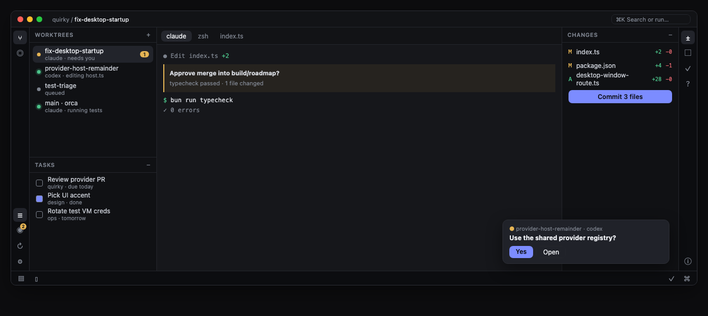
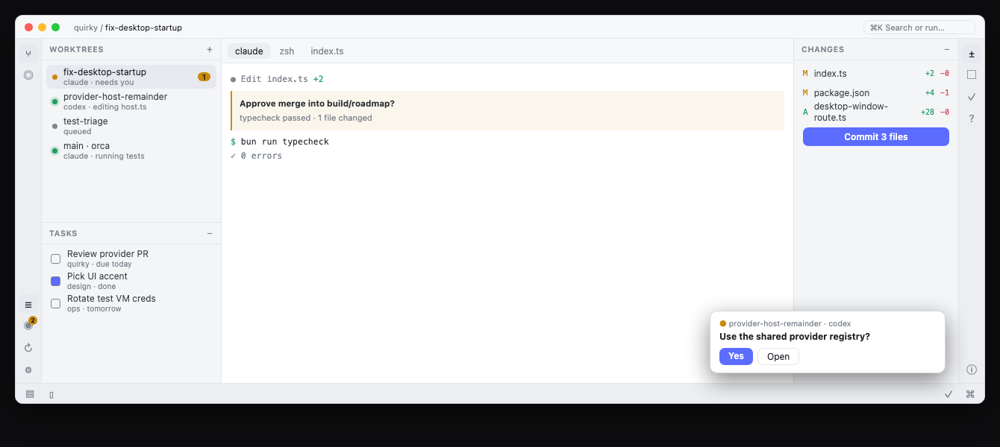
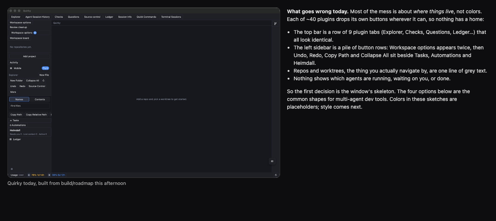
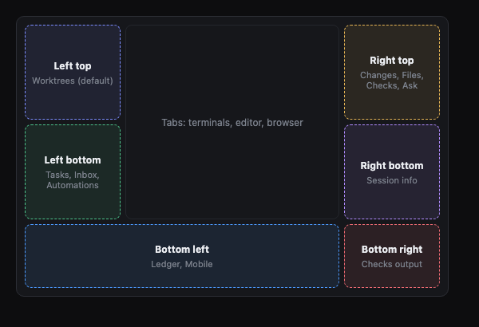
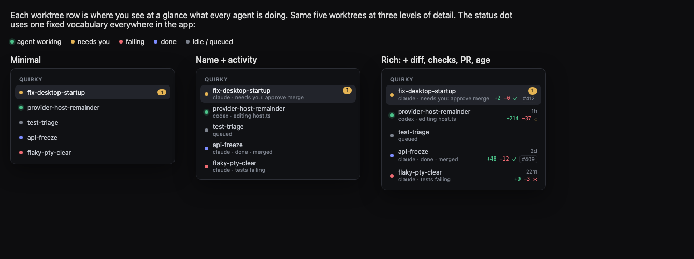
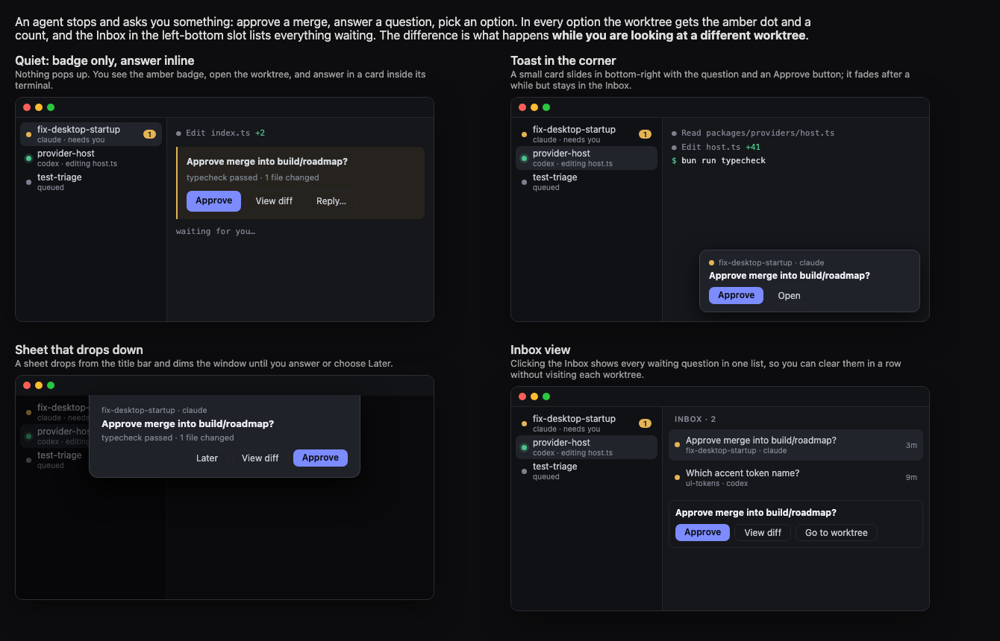
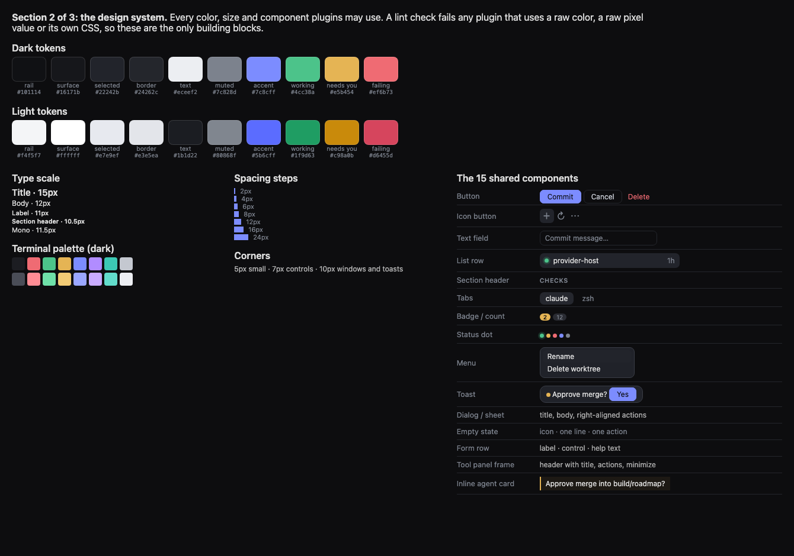

# Desktop UI redesign: calm graphite with tool slots

**Status:** Approved 2026-10-28

The desktop app gets one coherent look and a fixed home for everything on screen. The host draws every pixel of the window; plugins register tools, views, commands and status items and never place buttons of their own. Everything is built from one set of tokens and 15 shared components, in dark and light, and every restyled area must match the approved golden screen before it lands.





## Why

Quirky's UI today has no structure. About 40 plugins each put their own buttons wherever they could, so the top bar is a row of nine identical plugin tabs, the sidebar is a pile of button rows (Workspace options appears twice), repos and worktrees are one line of grey text, and nothing shows which agents are working or waiting. Styling comes from one 3,811-line stylesheet with 26 variables and 8 shared components. Fixing screens one at a time would never converge, because the next plugin built would drift again.



The reader of this spec is the build-loop lane that builds a redesign item, and the user, who looks once at the end. Each lane needs to know where things go, what they look like, and when its item is done.

## Conceptual model

### The window

The window has seven regions, and the host owns all of them.

| Region | What lives there | How a plugin gets something there |
|---|---|---|
| Title bar | Breadcrumb (project / worktree) and the ⌘K search box | Host only |
| Six tool slots | Every tool window: Worktrees, Inbox, Tasks, Changes, Files, Checks, Ledger and the rest | The plugin registers a tool: id, title, icon, default slot and the panel it renders |
| Center tabs | Terminals, agents, editor files, browser, diffs | The plugin registers a view type; the host draws the tab |
| Corner toasts | An agent needs you; short confirmations | The plugin raises an attention item; the host draws the toast and adds the item to the Inbox |
| Status bar | Branch, agents working, needs-you count, usage meters | The plugin registers a status item: text and an optional status dot |
| ⌘K | Every command, every tool, every worktree | The plugin registers commands |
| Settings | One settings window with a section per plugin | The plugin registers a settings section built from shared form rows |

A plugin may put controls inside its own panel, view, toast or settings section, and nowhere else. Today's top row of plugin tabs and the sidebar button piles go away: each entry becomes a tool, a command or a status item.

### Tool slots

Tool windows work like PyCharm's. Each side of the window has a top and a bottom slot, and the bottom edge has a left and a right half, so there are six slots. Every tool is an icon on the stripe beside its slot.



| Slot | Default tools |
|---|---|
| Left top | Worktrees |
| Left bottom | Inbox, Tasks, Agents (Heimdall), Automations, Mobile |
| Right top | Changes, Files, Checks, Ask, Reviews |
| Right bottom | Session info, Vault |
| Bottom left | Ledger, Terminal sessions, Quick commands |
| Bottom right | Checks output, Problems |

These rules hold for every slot:

- A slot shows one tool at a time, and its stripe shows every tool assigned to it.
- Clicking a stripe icon opens that tool in its slot, replacing whatever tool was showing there. Clicking the open tool's icon closes the slot.
- Dragging an icon to another stripe moves the tool there for good.
- When both slots on one side are open, that side splits, so Worktrees stays visible above whatever tool is open below it.
- The layout (which tool is in which slot, which slots are open, their sizes) is saved per user, not per project.
- On first launch Worktrees and Changes are open, and every other slot is closed.

### Worktree rows

Each worktree row shows a status dot, the worktree name, and a second line saying which agent is in it and what it is doing. A row with something waiting on you also shows an amber count.



The status dot uses one fixed meaning everywhere in the app:

| Dot | Meaning |
|---|---|
| Green with a halo | An agent is working |
| Amber | Needs you |
| Red | Failing (tests or checks) |
| Indigo | Done |
| Grey | Idle or queued |

### When an agent needs you

The amber dot and count appear on the worktree's row, the Inbox count goes up, and a toast slides in at the bottom right with the question and its main answer button. If Quirky is in the background, macOS shows a notification too. The toast fades after 8 seconds, and the item stays in the Inbox until it is answered.



## The design system

Every color, size and component a plugin may use is listed here. A lint check fails any plugin that uses a raw color, a raw pixel value or CSS of its own, so these are the only building blocks.



### Tokens

Colors come in a dark set and a light set with the same names. The app follows the macOS appearance, and Settings can pin it to dark or light.

| Token | Dark | Light | Used for |
|---|---|---|---|
| rail | #101114 | #f4f5f7 | Tool slots and stripes, a notch dimmer than the work |
| surface | #16171b | #ffffff | Center tabs and the terminal |
| selected | #22242b | #e7e9ef | The selected row and the active tab |
| border | #24262c | #e3e5ea | Every separator and outline |
| text | #eceef2 | #1b1d22 | Primary text |
| muted | #7c828d | #80868f | Secondary text, section headers, idle icons |
| accent | #7c8cff | #5b6cff | Indigo: selection, primary buttons, links, done |
| working | #4cc38a | #1f9d63 | Agent working, additions, passing checks |
| needs you | #e5b454 | #c98a0b | Waiting on the user, modified files |
| failing | #ef6b73 | #d6455d | Failures, deletions, destructive actions |

Sizes are fixed steps too.

| Kind | Steps |
|---|---|
| Type | Title 15, body 12, label 11, section header 10.5 (uppercase), mono 11.5 |
| Spacing | 2, 4, 6, 8, 12, 16, 24 |
| Corners | 5 for small marks, 7 for controls, 10 for windows and toasts |
| Row height | 26 for a one-line row, 32 to 34 for a two-line row (comfortable density) |

The terminal follows the theme with a matching graphite 16-color palette in dark and light, which the user can override in Settings.

### The 15 shared components

Button (primary, secondary, destructive), icon button, text field, list row, section header, tabs, badge or count, status dot, menu, toast, dialog or sheet, empty state, form row, tool panel frame, and the inline agent card. A plugin that needs something these don't cover asks for a new shared component; it never builds a local one.

## Behavior and scenarios

1. **Opening Quirky**
   - **Given** the user last left Worktrees open in left top, Tasks open in left bottom and Changes in right top
   - **When** they open Quirky
   - **Then** ✓ the same three tools open in the same slots at the same sizes; ✓ the last selected worktree is selected and its tabs reopen
2. **An agent in another worktree asks something**
   - **Given** the user is looking at **Worktree "provider-host"** and the agent in **Worktree "fix-desktop"** is running
   - **When** that agent asks "Approve merge into build/roadmap?"
   - **Then** ✓ **Worktree "fix-desktop"** shows an amber dot and a count of 1; ✓ the Inbox count goes up by 1; ✓ a toast with the question and an Approve button slides in at the bottom right; ✓ the user's view does not change
   - **Data before:** **Worktree "fix-desktop"**: green dot, no count; **Inbox**: 1 waiting*
   - **Walkthrough:**
     1. The agent in "fix-desktop" raises the question
     2. The host shows the toast; the user keeps working in "provider-host"
     3. Eight seconds later the toast fades
   - **Data after:** **Worktree "fix-desktop"**: amber dot, count 1; **Inbox**: 2 waiting, the newest first; no toast on screen
3. **Answering from the toast**
   - **Given** the toast from scenario 2 is on screen
   - **When** the user clicks Approve
   - **Then** ✓ the answer reaches the agent; ✓ the toast closes; ✓ the item leaves the Inbox; ✓ the worktree's dot returns to green once the agent resumes
4. **Opening and moving a tool**
   - **Given** Tasks is open in left bottom
   - **When** the user clicks the Automations icon on the left stripe, then drags the Ledger icon from the bottom stripe to the right stripe's bottom group
   - **Then** ✓ Automations replaces Tasks in left bottom; ✓ Ledger now lives in right bottom and opens there from then on, including after a restart
5. **Switching the Mac to light**
   - **Given** Quirky follows the system appearance
   - **When** macOS switches to light
   - **Then** ✓ the whole window, terminal included, switches to the light tokens at once, with no restart
6. **A tool with nothing to show**
   - **Given** the selected worktree has no changes
   - **When** the user opens Changes
   - **Then** ✓ the panel shows a one-line empty state with one action
   - **Screen copy:**
     ```
     No changes · Open terminal
     ```
7. **A plugin fails to load**
   - **Given** the Checks plugin throws while loading
   - **When** the user opens Checks
   - **Then** ✓ the Checks slot shows an error state with the plugin's name and a Reload action; ✓ every other tool and view keeps working
8. **A plugin breaks the rules**
   - **Given** a restyle item's diff adds `color: #ff0000` to a plugin panel
   - **When** the lane runs `bun run typecheck` before landing
   - **Then** ✗ the UI lint check fails and names the file and line; ✗ the item cannot land until the raw value is replaced with a token

## Rollout

The redesign runs as build-loop queue items. The first four start now, alongside the end phase, and touch only `packages/ui`, the design tokens and new files. The area restyles wait for `m7-api-freeze`, so they never collide with end-phase fixes.

| Queue item | Starts | Done when |
|---|---|---|
| ui-tokens-and-components | now | Dark and light tokens, the 15 components, a gallery page showing every component in both themes, and the lint check wired into `bun run typecheck` |
| ui-terminal-theme | now | Graphite terminal palette in dark and light, with a Settings override |
| ui-screenshot-review | now | A command that launches Quirky on a temporary home with fixture worktrees, captures every tool and view in dark and light, and has a separate reviewer model score each capture against the golden screens in this spec |
| ui-shell-slots | after ui-tokens-and-components | Title bar, six slots with stripes, click and drag behavior, saved layout, toasts, status bar and ⌘K; plugin registrations mapped to tools, views, commands and status items; the shell's own captures pass the screenshot review |
| ui-restyle-terminal | after api-freeze | terminal and terminal-dock pass the lint check and the screenshot review |
| ui-restyle-editor | after api-freeze | editor |
| ui-restyle-git | after api-freeze | git, reviews and checks |
| ui-restyle-browser | after api-freeze | browser |
| ui-restyle-worktrees | after api-freeze | worktree and repo |
| ui-restyle-agents | after api-freeze | agents, agent-status, session and session-info |
| ui-restyle-orchestration | after api-freeze | orchestration, heimdall, handoff and loops |
| ui-restyle-tasks | after api-freeze | tasks and automations |
| ui-restyle-ledger | after api-freeze | ledger |
| ui-restyle-accounts | after api-freeze | accounts and vault |
| ui-restyle-ask | after api-freeze | ask, notifications and structured |
| ui-restyle-settings | after api-freeze | mobile, cli, palette, sidebar-extras and the Settings window |
| ui-final-review | after every restyle | One page of before and after screenshots for every area, in dark and light, for the user's single look |

Every restyle item passes through the same two gates before it lands: the lint check (no raw colors, pixel values or plugin CSS) and the screenshot review against the golden screens. The user does not review items one by one; they look once, at `ui-final-review`.

## Scope and non-goals

In scope: the desktop app's window, the six tool slots, every plugin panel, view, dialog, toast and settings section, the terminal's colors, and dark and light themes.

Not in scope:

- The phone app
- New features or changed behavior; only where things live and how they look
- Custom themes or a user-picked accent color
- Tool windows floating in separate OS windows
- Changes to keyboard shortcuts

## Decisions Locked

Layout and structure

- The window is a worktree list, center tabs, and tools in side slots
- Tools use PyCharm-style slots: six slots, Worktrees in left top, workspace tools in left bottom by default, any tool movable to any slot
- Worktree rows show name plus activity (agent and what it is doing)
- An agent that needs you raises a corner toast, an amber badge and an Inbox entry

Look

- Calm graphite, like Linear
- Dark and light, following macOS, with a Settings override
- Indigo accent
- Comfortable density
- The terminal follows the theme, with a Settings override
- The combined golden screen (dark and light, above) is approved as the reference

Scope and rollout

- Desktop app only; the phone app is unchanged
- Tokens, components, the screenshot review and the new shell start now; area restyles start after api-freeze
- Plugins may use only shared components and tokens, enforced by a lint check
- Sign-off is the automated review on every item and one look by the user at the end
- Built as system first, then fanned out by area

## Industry Insights

- Linear builds each theme from three inputs (base color, accent and contrast) in LCH, keeps the sidebar a few notches dimmer than the content, and uses softer borders and fewer separators ([Linear, how we redesigned the Linear UI](https://linear.app/now/how-we-redesigned-the-linear-ui); [Linear, a calmer interface](https://linear.app/now/behind-the-latest-design-refresh)).
- Zed docks panels left, right and bottom, moves them by right-clicking the panel icon, and saves placement in settings ([Zed, new panel system](https://zed.dev/blog/new-panel-system)).
- VS Code keeps extension UI on host-styled contribution points (views, menus, commands) and treats webviews as a last resort; extension colors need light, dark and high-contrast defaults ([VS Code webview UX guidelines](https://code.visualstudio.com/api/ux-guidelines/webviews); [contribution points](https://code.visualstudio.com/api/references/contribution-points)).
- Obsidian tells plugin authors to use its CSS variables and classes instead of hardcoded styles, and its own settings builders instead of HTML headings ([Obsidian plugin guidelines](https://docs.obsidian.md/Plugins/Releasing/Plugin+guidelines)).
- Raycast limits extensions to its component kit (List, Grid, Detail and its navigation) and rejects extensions that swap views in place ([Raycast store preparation](https://developers.raycast.com/basics/prepare-an-extension-for-store)).
- Without standing constraints, AI coding agents invent new spacing and colors per component; the recommended fix is design-system rules the agent always reads and reuse before invention ([O'Reilly, design system as the control plane for AI-generated UI](https://www.oreilly.com/radar/the-design-system-as-the-control-plane-for-ai-generated-ui/)).
- A design-system migration case study judged a redesign combined with a front-end migration too risky and moved low-impact pages first ([Steven Yuan, design system migration](https://www.stevenyuan.me/case-studies/design-system-migration)).

## Deferred Ideas

- A bottom icon strip for workspace tools, shown during the slot discussion and set aside
- `[tech-spec]` How the screenshot review drives the app (accessibility tree, the existing native QA harness, or a test-only window route), and which reviewer model it uses
- `[tech-spec]` How the lint check finds raw values in TSX inline styles as well as CSS

## Glossary

- **Golden screen**: the approved combined mockup (dark and light, above) that every restyled area is compared against.
- **Slot**: one of the six places a tool window can open: left top, left bottom, right top, right bottom, bottom left, bottom right.
- **Stripe**: the thin icon column (or row, on the bottom edge) beside a slot, with one icon per tool assigned to it.
- **Tool**: a panel a plugin registers to open in a slot, such as Worktrees, Tasks or Changes.
- **View**: a kind of center tab a plugin registers, such as a terminal, an editor file or a browser page.
- **Attention item**: something an agent is waiting on the user for; it raises a toast and an Inbox entry.
- **Token**: a named color or size from the design system; plugins use only tokens.
- **Area restyle**: one queue item that moves one group of plugins onto the shared components and tokens.

## Status & amendments

Approved 2026-10-28.

**Amendments:**

- 2026-10-30: [the PyCharm shell spec](../2026-10-30-ui-pycharm-shell/logic.md#what-this-replaces) replaces the golden screens, title bar, status bar, bottom stripe and `rail` values here. Everything else stands.
