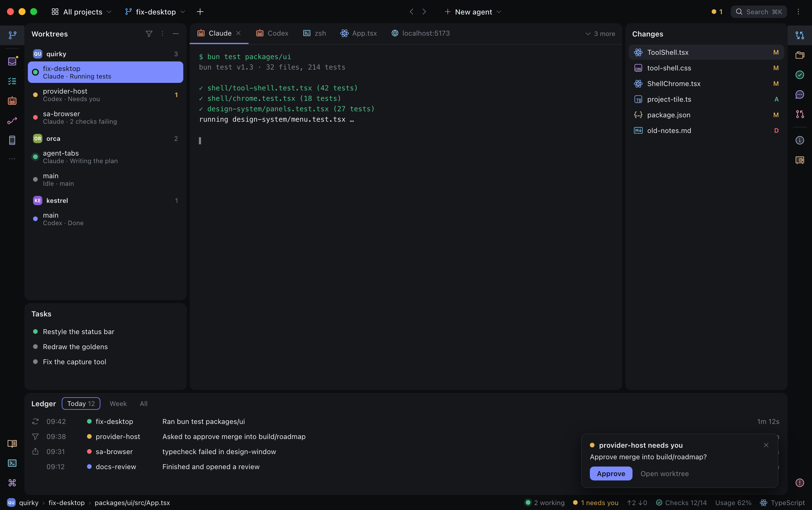
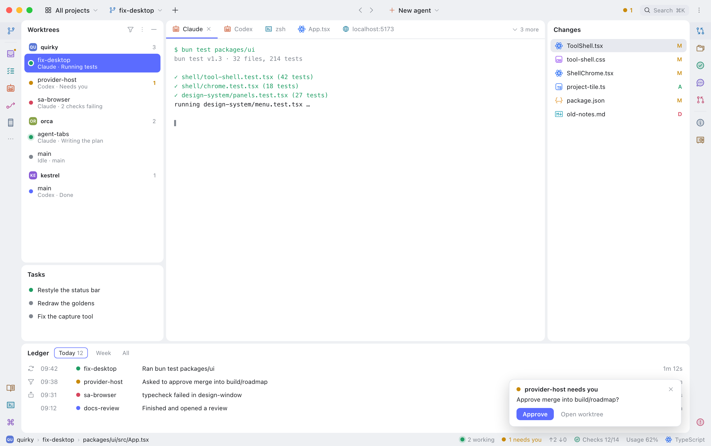
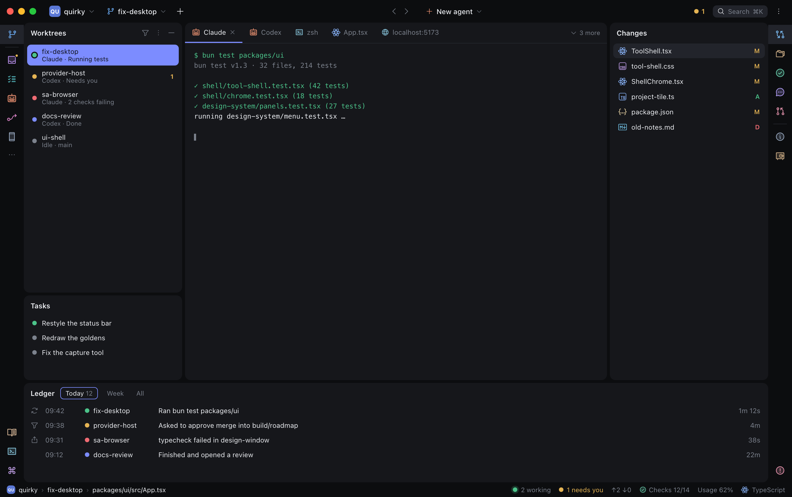
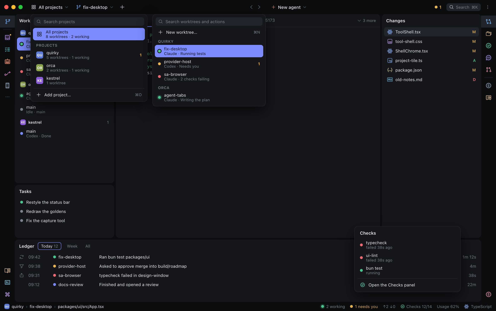

# Desktop shell: PyCharm's structure on calm graphite

**Status:** Approved 2026-10-30

The desktop window takes its structure from PyCharm: work sits on rounded cards, the Mac window bar carries the controls, one stripe on each side holds all the tool icons, and controls appear when a panel has focus. It keeps Quirky's calm graphite look and adds nothing that changes what the app can do, apart from narrowing the view to one project, the new popups and ⌘K scope tabs.

This spec replaces the parts of [the 10-28 redesign](../2026-10-28-ui-redesign/logic.md) named under [What this replaces](#what-this-replaces) and leaves the rest in force, including the six slots, the status dot meanings, the type and spacing scales, and the rule that plugins only use shared components and tokens.

The reader is whoever builds this and the user who checks the result. Each section says what the window must do, and [How we know it's done](#how-we-know-its-done) says when to stop.

## Why

The 10-28 redesign gave everything a fixed home, but the result still reads as flat panels split by lines, and the screenshot review scored it 50 and 69 against a pass mark of 85. Walking through PyCharm showed what the user likes about it:

- There are two layers, with the title bar, stripes and status bar on the window frame and all work on cards above it.
- The window bar says where you are, and each control opens a popup that can change it.
- One stripe does three jobs, so no separate row is needed for bottom panels.
- Focus turns things up, which is why a crowded window can still feel calm.
- All popups share one shape, so they only have to be learned once.
- The status bar holds live values you can click.

Quirky differs from PyCharm in one important way: PyCharm opens a window per project, while Quirky keeps every project in one window. That's why the project switcher here narrows a view instead of changing windows.

## What this replaces

These sections of the 10-28 spec no longer apply. Everything else in it stands.

| 10-28 section | Replaced by |
|---|---|
| Golden screens | [The golden screens](#the-golden-screens) |
| The window: Title bar row | [Window bar](#window-bar) |
| The window: Status bar row | [Status bar](#status-bar) |
| Tool slots: "Every tool is an icon on the stripe beside its slot", and the bottom stripe in the glossary | [Stripes](#stripes) |
| Tokens: `rail` values | [Frame and cards](#frame-and-cards) |
| Scope: "New features or changed behavior" | Project narrowing and the popups below are in scope |

## Conceptual model

### Frame and cards

Every panel and the center tabs are cards on the window frame, separated by a gap with no border lines. The window bar, stripes and status bar sit directly on the frame.

| Thing | Value |
|---|---|
| Frame, stripes, window bar, status bar | `rail` |
| Every card, including the center and the terminal | `surface` |
| Gap between cards | 5 |
| Card corner | 10, the existing window radius |
| `rail` in dark | `#0c0d0f`, was `#101114` |
| `rail` in light | `#eef0f3`, was `#f4f5f7` |

No new color token is added. The `rail` values change because the frame and cards need enough contrast to read as separate: the user's PyCharm theme has 1.10:1, Quirky had 1.05:1 in dark, and the new values give 1.09:1 in dark and 1.14:1 in light.

### Window bar

The Mac window bar and Quirky's own title bar merge into one 40-high bar. Reading left to right, it holds:

1. The traffic lights
2. The project switcher
3. The worktree switcher
4. New worktree
5. Back and forward, centered, followed by New agent
6. The needs-you count
7. Search with its ⌘K hint
8. Overflow, which holds Settings

Empty space in the bar still drags the window, and a control is never also a drag handle.

At the minimum 646-point window width, every control keeps a separate click target. Project and worktree labels ellipsize as needed. At 48rem and below, Search becomes icon-only and navigation may shift off-center to keep all actions visible.

New agent starts an agent tab in the selected worktree using the default agent, and its caret picks another agent. The bar shows no agent status, because a worktree can run several agents. Status stays in the tabs and worktree rows.

### Project narrowing

The project switcher starts on All projects, which shows every worktree in every project. Picking a project narrows the Worktrees panel and the worktree switcher to that project.

- The needs-you count, Inbox and toasts always cover every project, so narrowing never hides something waiting on the user.
- The narrowed project is remembered across restarts, like the rest of the layout.
- Under All projects, the Worktrees panel groups by project using the existing Group by option, with each project's tile on its section header.
- Narrowing to a project that doesn't contain the selected worktree selects that project's most recent worktree.
- Opening a worktree from outside the narrowed project, such as from a toast, returns the view to All projects, so the selected worktree is always visible.

### Project tile

Each project has a colored tile with two letters, shown in the project switcher, the Worktrees section headers and the status bar. The window bar is never tinted. A project's existing identity color is used when it has one, and otherwise the color comes from its name. The color can't be the full-strength status green, amber, red or indigo.

### Stripes

Each side's stripe runs top to bottom in this order:

1. The tools for that side's upper slot
2. A separator
3. The tools for that side's lower slot
4. On the left stripe only, an overflow button
5. Empty space
6. At the foot, the tools for the bottom slot on that side

The row of bottom-tool icons is removed, which gives the work about 40 more height. The six slots and their rules are unchanged: left foot opens bottom left and right foot opens bottom right. The open tool's icon gets a full-width `selected` block rather than a small rounded square.

Overflow lists tools that aren't on a stripe, either because the user took them off or because the window is too short to fit them, and shows their shortcuts where they have one.

### Icons

Tools use Phosphor Duotone, each in one fixed hue. Files use Catppuccin, Mocha in dark and Latte in light. Controls such as carets and search use Phosphor Regular in the text color. All of these are MIT licensed.

A plugin registering a tool names a Phosphor icon and a hue from the palette below, and the lint check rejects anything else. Hues stay clear of the status colors, which keep their meanings from the 10-28 spec. Tools can share a hue, because the palette has fewer hues than there are tools.

| Tool | Icon | Dark | Light |
|---|---|---|---|
| Worktrees | git-branch | `#6fb3ff` | `#2f74c0` |
| Inbox | tray | `#c79bff` | `#7f4fc9` |
| Tasks | list-checks | `#5fd0d6` | `#14808a` |
| Agents | robot | `#ff9d7a` | `#c9562f` |
| Automations | flow-arrow | `#e48ad0` | `#b3438f` |
| Mobile | device-mobile | `#9fb0c8` | `#566a84` |
| Changes | git-diff | `#7fc4ff` | `#2a78b8` |
| Files | folders | `#d6b58c` | `#8f6a3a` |
| Checks | check-circle | `#6dd6b4` | `#1a8a6b` |
| Ask | chat-circle-dots | `#b8a4ff` | `#6a52c4` |
| Reviews | git-pull-request | `#f29bb6` | `#c04a70` |
| Session info | info | `#9fb0c8` | `#566a84` |
| Vault | vault | `#d6b58c` | `#8f6a3a` |
| Ledger | book-open-text | `#e6c3a0` | `#94683c` |
| Terminal sessions | terminal-window | `#8fd0e8` | `#1f7f9e` |
| Quick commands | command | `#c9a6f0` | `#8350bd` |
| Problems and Checks output | warning-circle | `#f29bb6` | `#c04a70` |

### Focus

A panel shows its header buttons only when it has focus or the pointer is over it, and the buttons stay reachable by keyboard. The selected row is `accent` in the focused panel and `selected` in every other panel. A dot on an `accent` row gets a ring so its color stays readable. An inactive window dims as a whole.

### Panels

A panel's title and tabs share one header row, and tabs show their counts. Its tools run down a rail on the left edge, and its rows take the rest of the width. A side panel too narrow for the rail puts those tools in a row under the header instead.

### Popups

One shared popup shape serves the project switcher, the worktree switcher and status bar items. It has an optional search field, section headers, shortcuts on the right, and a pill on the selected row. Only one popup is open at a time, and Escape closes it. The reference sheet below shows three together only to save space.

- **Project switcher:** All projects, each project with worktree and working counts and any needs-you count, then Add project.
- **Worktree switcher:** New worktree, then each worktree with its status dot and activity, grouped by project under All projects.
- **Status bar items:** a titled list with a link to the matching panel.

### Status bar

The left side is a breadcrumb of the selected project, worktree and open file, which always names the project even under All projects. The right side holds, in order: working count, needs-you count, ahead and behind, checks, usage, and file type. Each right-side value opens a popup, except file type. Plugins still add items by registering them.

### Center tabs and ⌘K

Center tabs show a tool or file icon and an accent underline on the active tab, with a close button on the active or hovered tab. When tabs don't fit, a "3 more" button at the end of the row lists the hidden ones, and the visible tabs don't shrink to fit.

⌘K gains scope tabs for All, Worktrees, Commands and Files, and shows recent items before anything is typed.

## The golden screens

These replace the 10-28 golden screens and are what every screenshot review scores against. The user approved them on 2026-10-30. Their content is made up.

- [Shell, dark](img/golden-shell-dark.png) and [light](img/golden-shell-light.png), with Worktrees focused and a toast showing
- [One project, dark](img/golden-scoped-dark.png) and [light](img/golden-scoped-light.png)
- [Popups, dark](img/golden-popups-dark.png) and [light](img/golden-popups-light.png)

## Behavior and scenarios

1. **Seeing everything across projects**
   - **Given** the project switcher is on All projects
   - **When** the user looks at the Worktrees panel
   - **Then** ✓ every worktree in every project is listed under its project's tile; ✓ the switcher reads All projects
   - **Data before:** **Project "quirky"**: 5 worktrees\*; **Project "orca"**: 2 worktrees\*; **Project "kestrel"**: 1 worktree\*
   - **Data after:** **Worktrees panel**: ✓ 8 rows under 3 section headers; **Project switcher**: ✓ "All projects · 8 worktrees"
2. **Narrowing to one project**
   - **Given** All projects is showing and **Worktree "agent-tabs"** in **Project "orca"** is selected
   - **When** the user opens the project switcher and picks **Project "quirky"**
   - **Then** ✓ the panel and the worktree switcher list only that project's worktrees; ✓ that project's most recent worktree is selected; ✓ the switcher shows its tile and name
   - **Data before:** **Project switcher**: All projects; **Selected worktree**: "agent-tabs" in "orca"
   - **Data after:** **Project switcher**: ✓ "quirky"; **Worktrees panel**: ✓ 5 rows\*; **Selected worktree**: ✓ "fix-desktop"\* in "quirky"
3. **An agent in a hidden project asks something**
   - **Given** the view is narrowed to **Project "quirky"** and the agent in **Worktree "agent-tabs"** in **Project "orca"** is running
   - **When** that agent asks a question
   - **Then** ✓ the needs-you count goes up; ✓ a toast appears; ✓ the Inbox gets the item; ✓ the view stays on "quirky"
   - **Data before:** **Needs-you count**: 1\*; **Project switcher**: "quirky"
   - **Walkthrough:**
     1. The agent in "agent-tabs" raises the question
     2. The host shows the toast while the user keeps working
   - **Data after:** **Needs-you count**: ✓ 2; **Project switcher**: ✓ "quirky"
4. **Opening that worktree from the toast**
   - **Given** the toast from scenario 3 is showing
   - **When** the user clicks Open worktree
   - **Then** ✓ the view returns to All projects; ✓ "agent-tabs" is selected and visible
   - **Data before:** **Project switcher**: "quirky"; **Selected worktree**: "fix-desktop"\*
   - **Data after:** **Project switcher**: ✓ All projects; **Selected worktree**: ✓ "agent-tabs"
5. **Starting a second agent**
   - **Given** **Worktree "fix-desktop"** already has a Claude tab running
   - **When** the user clicks New agent in the window bar
   - **Then** ✓ a new agent tab opens in "fix-desktop" using the default agent; ✓ the existing tab keeps running; ✓ the window bar still shows no agent status
6. **Dragging the window**
   - **Given** the window bar is showing
   - **When** the user drags from empty bar space, then drags from the project switcher
   - **Then** ✓ the first drag moves the window; ✗ the second does not move it, and a click on that control opens its popup instead
7. **Opening a bottom tool from the side stripe**
   - **Given** the bottom row no longer exists and Ledger is in the bottom left slot
   - **When** the user clicks the Ledger icon at the foot of the left stripe
   - **Then** ✓ Ledger opens as a card along the bottom; ✓ the Ledger icon gets the full-width block
8. **Focus moves between panels**
   - **Given** Worktrees has focus and Changes has a selected row
   - **When** the user clicks a row in Changes
   - **Then** ✓ Changes shows its header buttons and an `accent` selection; ✓ Worktrees loses its buttons and its selection turns `selected`
9. **Reaching hidden controls by keyboard**
   - **Given** a panel's header buttons are hidden
   - **When** the user tabs into that panel
   - **Then** ✓ the buttons appear and can each take focus
10. **A plugin picks a status color for its tool**
    - **Given** a plugin registers a tool with a hue outside the palette
    - **When** the lint check runs
    - **Then** ✗ the check fails and names the file and line
11. **Too many tabs**
    - **Given** the center is too narrow for all of a worktree's tabs
    - **When** the user clicks "3 more"
    - **Then** ✓ a popup lists the 3 hidden tabs; ✓ picking one makes it the active tab

## How we know it's done

The work is done when all of these hold, and the user then takes one final look at a before-and-after page.

- Every shared layer's screenshots score at least 85 against the new golden screens, in dark and light. The threshold is the one the existing review uses and doesn't change.
- The window bar is checked in a native capture, because the browser-rendered review can't see the traffic lights or window dragging.
- The UI lint check passes, including the new icon and hue rule, and the affected test suites pass.
- Each scenario above has been run in the real app.

Failing tests in `plugins/quirky.worktree` that the 10-29 work recorded in `docs/loop/BLOCKERS.md` predate this spec. Anything those failures touch has to be told apart from a new regression, so the final report states which is which instead of calling the suite green.

## Rollout

It's built system first on one branch, so `main` never shows a half-converted look, with a checkpoint commit per phase. The phases run in this order because each depends on the one before it:

1. Fix the screenshot capture tool, which still looks for an element the six-slot shell removed, and swap in the new golden screens.
2. Tokens and icons: the `rail` values, the hue palette, the icon sets and the lint rule.
3. The shell: frame and cards, the merged window bar, stripes and status bar.
4. Shared panel frame, focus behavior and the shared popup.
5. Project narrowing, both switchers and status bar popups.
6. Center tabs and ⌘K scopes.
7. Cleanup for plugins whose panels draw their own toolbars, followed by the final review page.

## Scope and non-goals

In scope: the desktop window on macOS, both themes, and every shared layer above. Plugin panels change only where they draw their own toolbars or headers.

Not in scope:

- The phone app
- Tinting the window bar with the project's color
- Separate windows per project
- A setting for hiding controls or turning off focus dimming
- Linux and Windows window bars, which get a platform note in the tech spec
- PyCharm's file settings in the status bar, such as line endings, encoding and indent
- Inline blame
- The later projects listed under [Deferred Ideas](#deferred-ideas)

## Decisions Locked

Layout

- All work sits on cards, with `surface` on a `rail` frame, approved by the user
- The window bar holds the project switcher, worktree switcher, New worktree, back and forward, New agent, needs-you count, search and overflow, approved by the user
- All tools live on the side stripes and the bottom row goes away, approved by the user
- Panel titles and tabs share a line, with tools in a left rail, approved by the user
- The status bar is a breadcrumb plus working, needs-you, ahead and behind, checks, usage and file type, approved by the user

Look

- Projects are marked by a tile only, with no tint, approved by the user
- Tools use Phosphor Duotone and files use Catppuccin, approved by the user
- Controls appear on focus or hover, with focused and unfocused selection colors and an inactive window dimming, approved by the user
- The approved golden screens are the reference, approved by the user

Behavior

- The project switcher narrows the view, with All projects as the default, approved by the user
- All projects stays the panel's default, grouped by project, and approved in the golden screens
- New agent is a plain button with no status, because a worktree can run several agents, approved by the user
- Project, worktree and status bar popups are all in, approved by the user
- Tabs get icons, an underline and an overflow list, and ⌘K gets scope tabs, approved by the user
- Opening a worktree from outside the narrowed project returns to All projects, stated to the user with the golden screens, who approved without changing it
- The narrowed project is remembered across restarts: assumed
- Narrowing selects the project's most recent worktree: assumed
- A project's tile uses its existing identity color, or one from its name: assumed
- Overflow lists tools off the stripe or that don't fit, on the left stripe only: assumed
- File type in the status bar opens no popup: assumed
- New agent's caret picks another agent: assumed

Process

- Built system first on one branch, approved by the user
- The user approved the golden screens first and takes one final look at the end, with automated checks in between

## Industry Insights

The JetBrains sources below are partly search excerpts, because several pages couldn't be fetched, and the community items are small threads rather than surveys.

- JetBrains' stated goals for its New UI are less visual complexity, easy access to essentials, and progressive disclosure ([New UI help](https://www.jetbrains.com/help/idea/new-ui.html)).
- JetBrains' Islands look uses rounded panels with gaps and "no visible border by design" and asks for 1.20:1 contrast between panels and the window background ([Supporting Islands theme](https://plugins.jetbrains.com/docs/intellij/supporting-islands-theme.html)). The user's own theme is 1.10:1 and this spec is close to that, because the user approved how it looks.
- JetBrains users complained that tools were unidentifiable once stripe icons lost color and labels. This is opinion from one thread ([r/IntelliJIDEA](https://www.reddit.com/r/IntelliJIDEA/comments/1pkv138/island_theme_looked_interesting_so_tried_new_ui/)).
- A Microsoft Research study found multi-color icons easiest to tell apart, and it stressed judicious use of color ([Microsoft Research](https://www.microsoft.com/en-us/research/articles/why-your-users-value-color-icons-more-than-you-may-think/)).
- Hidden title bar drag strips need to be big enough to grab, and a control must never also be a drag handle ([Element Web PR 33991](https://github.com/element-hq/element-web/pull/33991)).
- Traffic-light spacing tied to one title bar mode has caused long-running bugs in VS Code ([issue 208226](https://github.com/microsoft/vscode/issues/208226)).
- Linear reverted nesting that added steps to frequently used views, saying "we moved a bit too quickly" ([Linear changelog](https://linear.app/changelog/2022-02-11-sidebar-update)).

## Deferred Ideas

Each of these would be its own project.

- A three-pane Git log with a branch tree, commit graph with colored lanes, and commit details, possibly tagging commits with the worktree that has them checked out
- Run arrows beside `package.json` scripts in the editor
- `[tech-spec]` How the Mac window bar merges under Electrobun, and whether the current window code really shows two bars, which so far has only been read from the code and not checked in the running app
- `[tech-spec]` How the icon sets are packaged and how the lint check validates icon and hue names
- `[tech-spec]` How the capture tool is repaired, and how the native window bar capture works
- `[tech-spec]` Which plugins draw their own toolbars and need the cleanup phase

## Glossary

- **Frame:** the window background that the bar, stripes and status bar sit on.
- **Card:** a rounded `surface` area holding a panel or the center tabs.
- **Golden screen:** an approved mockup that screenshot reviews score against.
- **Narrowing:** showing one project's worktrees in the Worktrees panel and worktree switcher.
- **Project tile:** the small colored square with a project's two letters.
- **Slot, stripe, tool, view, token:** as defined in [the 10-28 spec](../2026-10-28-ui-redesign/logic.md#glossary), with the stripe change above.

## Status & amendments

Approved 2026-10-30, including the decisions marked assumed. Tech spec: expected, because this crosses many files and adds native window chrome.

**Amendments:**

- 2026-10-30: the icon table's Agents row is the tool registered as Heimdall. Problems and Checks output aren't registered today, so the right stripe's foot group is empty until one exists. That's the only way the running app differs from the golden screens' stripe. Remote workspaces, Activity and Dashboard weren't in the table and use `slate`, `coral` and `mint` with the icons `hard-drives`, `pulse` and `gauge`.
- 2026-10-31: clarified the Window bar's minimum-width behavior after QA found overlapping picker and navigation controls.
