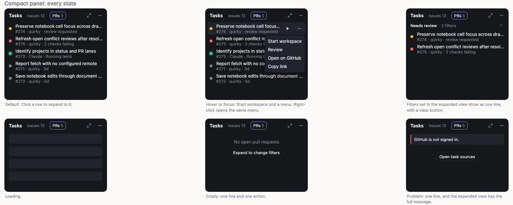
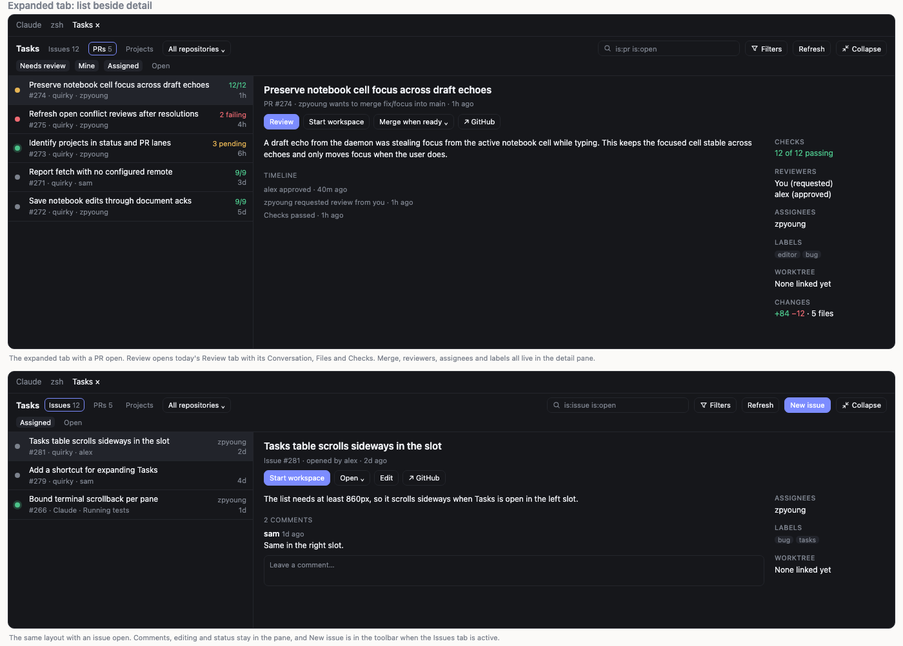
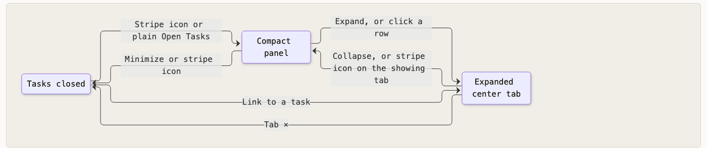
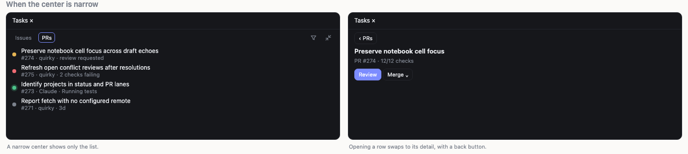
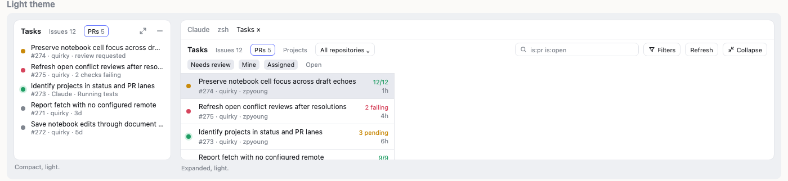

# Tasks: a compact panel that expands into a center tab

**Status:** Approved 2026-11-01

Tasks becomes one tool with two forms. Its side panel is a short list you can glance at, and Expand moves it into a center tab with the list beside a full detail pane. Both forms read the same list, filters and selection, so moving between them never loses your place.

The reader is whoever builds this and the user who checks the result. [How we know it's done](#how-we-know-its-done) says when to stop.





## Why the panel has to change

The Tasks slot and the Tasks center tab mount the same page. Its table needs at least 860px for issues and about 1120px for PRs, and a slot opens at 280px, so in the side panel the list scrolls sideways and its columns are out of sight. The panel is the first thing you see, and it's the least usable form of the tool.

## This replaces one line of the Tasks restyle spec

[The Tasks restyle spec](../2026-10-28-ui-restyle-tasks/logic.md) locks "no custom shell buttons or center-tab takeover". This spec allows Tasks into a center tab when you ask for it. The rest of that spec stands, including its first acceptance criterion: opening Tasks from its stripe icon leaves your center work alone.

Every other shell rule still holds. Tasks uses only shared components and tokens, the host draws the tab, and the status dots keep their [fixed meanings](../2026-10-28-ui-redesign/logic.md#worktree-rows).

## Conceptual model

### Tasks is in one of three places

Tasks is closed, in its panel, or in its center tab. It's never in the panel and the tab at the same time, so there is only ever one list on screen.



| From | Action | Result |
|---|---|---|
| Closed | Stripe icon, or a plain Open Tasks | Panel |
| Closed | A link to a specific task | Tab, with that row open |
| Panel | Expand | Tab, with any row you had open still open |
| Panel | Click a row | Tab, with that row open |
| Panel | Minimize, or stripe icon | Closed |
| Tab | Collapse | Panel |
| Tab | Stripe icon, when Tasks is the showing tab | Panel |
| Tab | Stripe icon or a plain Open Tasks, when another tab is showing | Stays in the tab and switches to it |
| Tab | The tab's × | Closed |

Tasks remembers its place in all three. The tab, row, scroll position, page and filters are the same when it comes back, including after a close.

### The panel is for glancing, the tab is for working

The panel answers "where do things stand?" and offers one action. Anything that needs reading, comparing or confirming happens in the tab.

| Capability | Panel | Expanded tab |
|---|---|---|
| Issues and PRs lists | ✓ | ✓ |
| Tab counts | ✓ | ✓ |
| Start or resume a workspace | ✓ | ✓ |
| Review, Open on GitHub, Copy link | ✓ in the row menu | ✓ |
| See active filters and clear them | ✓ as one line | ✓ |
| Projects: table, board and roadmap | | ✓ |
| Search, presets, filters, repository picker | | ✓ |
| Refresh, Open repository in GitHub, issue source | | ✓ |
| Task settings | | ✓ |
| Merge, auto-merge, reviewers | | ✓ in the PR detail |
| Assign, labels, close and reopen, edit, comment | | ✓ in the issue detail |
| New issue | | ✓ on the Issues tab |
| Pagination | A final "More tasks" row that expands | ✓ |

### Compact rows use the worktree row and its dots

A compact row is the same 34px two-line row as a worktree row: a status dot, the title, then a second line saying where the task stands. If more than one dot applies, the first match in this table wins.

| Dot | Meaning on a task | Second line |
|---|---|---|
| Amber | Your review is requested, changes were requested on your PR, or a linked agent is asking you something | `#274 · quirky · review requested` |
| Red | Checks are failing on your own PR | `#275 · quirky · 2 checks failing` |
| Green with a halo | An agent is working in a linked worktree | `#273 · Claude · Running tests` |
| Indigo | The task is merged or closed | `#271 · quirky · merged 3d ago` |
| Grey | Nothing is waiting on you | `#266 · quirky · waiting on alex`, or `#268 · orca · 2d` |

A merged or closed task only appears when the active filters include it, or until the next refresh if it was merged from this view.

### The expanded tab is a list beside a detail pane

The toolbar runs across the top of the tab: Issues, PRs and Projects tabs, the repository picker, search, filters, presets, Refresh and Collapse. On the Issues tab it also has New issue. A toolbar menu holds Task settings, Open repository in GitHub and the issue source. Below it, a list of about 380px sits beside the detail pane, and the list's rows put checks and age on the right.

- **PR detail** shows the title, description, timeline, checks, reviewers, assignees, labels, linked worktree and changes. Its actions are Review, Start workspace, the merge menu and Open on GitHub. Review opens today's Review tab with Conversation, Files and Checks, so code review doesn't move into this pane.
- **Issue detail** is today's issue page in the pane: description, comments, comment box, editing and status.
- **With no row open**, the pane shows a one-line prompt to pick a task.
- **Projects** takes the whole area below the toolbar, because its table, board and roadmap need the width. Picking a project item opens it the way it does today.



When the tab is narrower than about 760px, it shows the list alone. Opening a row swaps to its detail, with a back button to the list.

### Dark and light use the same tokens

Both forms use the shared tokens, so the light theme needs no separate design.



## Data flow

The list, filters, page and open row already live in the daemon's Tasks state, so the panel and tab read one copy of them. Expand and Collapse only change where that state is drawn. Row status comes from the same reads the list makes today, and checks and merge details load after the row appears. A row therefore starts grey with its age, then takes its real dot and second line when they arrive.

## Key decisions and why

- **One list on screen.** Showing the panel beside a tab of the same list would use 280px to say the same thing twice, so Expand closes the panel.
- **A click is Expand aimed at a row.** There's one behavior to learn and one place a task is read. This costs one extra click to reach Review from a PR, and the panel closes on every click, which the user accepted.
- **The panel keeps Issues and PRs tabs.** This matches the expanded view and today's habit. A busy repo will fill the panel with work that isn't yours, and the filters set in the tab are how you narrow it. The "my work" grouped list was shown and not chosen.
- **The dot follows the app's meanings.** A new vocabulary for tasks would mean learning two meanings for the same colors.
- **Merge and assign stay out of the panel.** They carry safety messages and pickers that don't fit in 280px, and a mistaken merge is the worst thing a row could do.
- **Filter changes happen in the tab.** The panel only reports and clears them, because a picker or search field would take a row from a panel that's already short of height.

## Behavior and scenarios

1. **Opening Tasks from the stripe**
   - **Given** Tasks is closed and a terminal tab is showing
   - **When** the user clicks the Tasks stripe icon
   - **Then** ✓ the panel opens in the slot Tasks lives in; ✓ the terminal tab stays showing; ✓ no center tab opens
2. **Expanding**
   - **Given** the panel is open on the PRs tab with no row opened yet
   - **When** the user presses Expand
   - **Then** ✓ the panel closes and a Tasks center tab opens and shows; ✓ the PRs tab and filters are unchanged; ✓ the detail pane shows its one-line prompt; ✓ other center tabs stay open behind it
3. **Clicking a compact row**
   - **Given** the panel is open with **PR #274** on the list
   - **When** the user clicks that row
   - **Then** ✓ the panel closes and the Tasks tab opens with **PR #274** open in the detail pane; ✓ the Review tab does not open
   - **Walkthrough:**
     1. The user clicks **PR #274** in the panel
     2. The tab opens with that row selected and its detail showing
     3. The user presses Review, and today's Review tab opens
4. **Collapsing keeps your place**
   - **Given** the tab is showing the PRs tab, filtered to Needs review, on page 2, scrolled down, with **PR #268** open
   - **When** the user presses Collapse
   - **Then** ✓ the tab closes and the panel opens in the slot Tasks lives in; ✓ the panel shows the same PRs, filter and page; ✓ **PR #268** is highlighted and scrolled into view; ✓ keyboard focus is on that row
   - **Data before:** **Tasks tab**: PRs, Needs review, page 2, **PR #268** open
   - **Data after:** **Panel**: ✓ PRs, Needs review, page 2, **PR #268** highlighted; **Tasks tab**: closed
5. **Expanding again after a collapse**
   - **Given** the user collapsed with **PR #268** open
   - **When** they press Expand
   - **Then** ✓ the tab reopens with **PR #268** still open
6. **Collapsing from Projects**
   - **Given** the user opened PRs, then moved to Projects in the tab
   - **When** they press Collapse
   - **Then** ✓ the panel shows the PRs tab; ✓ expanding again returns to Projects
7. **Collapsing when another tool took the slot**
   - **Given** Tasks is expanded and the user has since opened Automations in the slot Tasks lives in
   - **When** they press Collapse
   - **Then** ✓ Tasks replaces Automations in that slot, the same as clicking a stripe icon
8. **The stripe icon while expanded**
   - **Given** Tasks is expanded
   - **When** the user clicks the Tasks stripe icon
   - **Then** (a) if a terminal tab is showing, ✓ the Tasks tab comes forward; (b) if the Tasks tab is showing, ✓ it collapses to the panel; ✓ the panel and tab are never both open
9. **Closing the tab**
   - **Given** Tasks is expanded with **Issue #281** open
   - **When** the user presses the tab's ×
   - **Then** ✓ the tab closes and the panel stays closed; ✓ clicking the stripe icon later opens the panel with **Issue #281** highlighted
10. **Opening from elsewhere**
    - **Given** Tasks is in its panel
    - **When** (a) something opens a link to **Issue #281**, or (b) the user runs Open Tasks from ⌘K
    - **Then** (a) ✓ the panel closes and the tab opens with **Issue #281** open; (b) ✓ the panel stays as it is
11. **Starting work from a compact row**
    - **Given** the pointer or keyboard focus is on a row with no linked worktree
    - **When** the user presses Start workspace
    - **Then** ✓ today's workspace composer opens; ✓ Tasks stays in its panel; ✓ a row that already has a linked worktree offers Resume instead
    - **Screen states:**

      | Element | Default | Hover or focus |
      |---|---|---|
      | Start workspace or Resume button | ✗ hidden | ✓ shown |
      | Menu button | ✗ hidden | ✓ shown |
      | Right-click menu | ✓ available | ✓ available |
      | Menu items | | Start workspace, Review on PRs, Open on GitHub, Copy link |

12. **Filters set in the tab show in the panel**
    - **Given** the user filtered PRs to Needs review plus one label, then collapsed
    - **When** the panel shows
    - **Then** ✓ one line under the header names the preset and the filter count; ✓ its clear button resets to the default view; ✓ with no filters, the line isn't there
    - **Screen copy:**
      ```
      Needs review · 2 filters  ×
      ```
13. **A row that hasn't finished loading**
    - **Given** the list has arrived but a PR's checks and review details haven't
    - **When** the panel shows that row
    - **Then** ✓ it shows a grey dot and its project and age; ✓ it changes to its real dot and second line when they arrive, without moving position
14. **A list longer than a page**
    - **Given** the current page isn't the last
    - **When** the user scrolls to the end of the panel
    - **Then** ✓ a final "More tasks" row appears; ✓ clicking it expands, so paging happens in the tab
15. **Counts that aren't known**
    - **Given** the count for the Issues tab couldn't be read
    - **When** the panel shows
    - **Then** ✓ the tab reads "Issues" with no number, rather than a wrong number or an error
16. **Empty, loading and problem states in the panel**
    - **Given** the panel has nothing to list
    - **When** it shows
    - **Then** ✓ each state fits a line or two with at most one action, and the tab carries the full message
    - **Screen states:**

      | State | Panel shows |
      |---|---|
      | Loading | Skeleton rows |
      | Nothing matches | "No open pull requests", with Expand to change filters |
      | No repositories selected | One line, with Expand to select projects |
      | GitHub unavailable or not signed in | One line, with Open task sources |
      | Some repositories failed | The rows that loaded, with one warning line |

17. **A narrow panel or a wide slot**
    - **Given** Tasks is moved to any slot and resized anywhere from 160px up to its widest
    - **When** the panel shows
    - **Then** ✓ it never scrolls sideways; ✓ titles and second lines shorten with an ellipsis; ✓ it stays a compact list, even in a wide bottom slot
18. **A narrow center**
    - **Given** the Tasks tab is narrower than about 760px
    - **When** the user opens a row
    - **Then** ✓ the detail replaces the list; ✓ a back button returns to the list at the same scroll position
19. **Merging from the detail pane**
    - **Given** **PR #274** is open in the detail pane and eligible to merge
    - **When** the user opens the merge menu
    - **Then** ✓ it offers the same methods, safety messages and auto-merge choices as today's list; ✓ the row and its dot update once the merge lands
20. **Escape**
    - **Given** the Tasks tab is showing
    - **When** the user presses Escape
    - **Then** ✓ it closes an open menu or dialog first; ✓ otherwise it clears the open row; ✓ with no row open, it collapses to the panel; ✓ Escape in the panel closes only an open menu

## How we know it's done

The user chose these four as the bar:

- The panel never scrolls sideways at any width a slot allows, down to its 160px minimum, including when Tasks is moved to another slot.
- Everything Tasks can do today stays reachable, using the [capability table](#the-panel-is-for-glancing-the-tab-is-for-working) as the checklist.
- Expand then Collapse keeps your tab, row, scroll position, page, filters and keyboard focus.
- The panel and tab pass the screenshot review against the approved golden screens, in dark and light.

Keyboard behavior is specified in the scenarios above but isn't a separate acceptance bar.

## Scope and non-goals

In scope: the Tasks panel, the Tasks center tab, moving between them and the capabilities they hold.

Not in scope:

- The phone app, which has its own Tasks panel
- Tasks' daemon methods and CLI commands, whose results don't change
- The Review tab
- Projects' table, board and roadmap, apart from where they're opened
- Automations, which has a similar layout
- New filters, sort orders or task sources

## Decisions Locked

Expand and movement

- Expand moves Tasks into a center tab and closes the panel
- Clicking a compact row expands with that row open
- The stripe icon goes to the Tasks tab if it's behind another tab, and collapses if it's showing
- The tab's × closes Tasks with the panel left closed
- A link to a specific task expands; a plain Open Tasks opens the panel

Compact panel

- It lists Issues and PRs under tabs, as today
- Rows use two lines, matching worktree rows
- Rows offer Start workspace plus a menu on hover and keyboard focus; right-click opens the same menu
- Active filters show as one line with a clear button; changing them means expanding

Expanded tab

- The layout is a list beside a detail pane
- Projects appears only in the expanded view

Done

- The bar is no sideways scrolling, nothing lost, place kept and the screenshot review

Chosen during design and approved on the visual sheet

- A narrow center swaps between list and detail
- The panel stays compact in any slot

Set while writing this spec and approved with it

- If more than one dot applies, the order is amber, red, green, indigo, grey
- Red applies only to your own PRs
- A merged or closed task shows only while the filters include it, or until the next refresh
- A final "More tasks" row handles lists longer than a page
- A narrow center means under about 760px
- Escape closes a menu, then clears the open row, then collapses
- Task settings, Open repository in GitHub and the issue source sit in a toolbar menu

## Industry Insights

- JetBrains' pull request tool window keeps the list in the tool window and opens a PR's overview as a tab in the editor area, the closest match to this design. Its docs don't say whether the list stays visible ([IntelliJ IDEA, work with GitHub pull requests](https://www.jetbrains.com/help/idea/2025.1/work-with-github-pull-requests.html)).
- Linear's Split Inbox puts the list beside the focused issue so you can triage without leaving it ([Linear changelog](https://linear.app/changelog/2021-12-02-workspace-templates)). SAP's guidance suggests a one-third to two-thirds split and advises against bulk editing inside a master list ([SAP Fiori master-detail](https://www.sap.com/design-system/hcm/patterns/structure-and-layout/master-detail/usage)).
- One product's expanded page left users with no way back to where they came from, and the fix recorded the origin and kept the same item open ([Vigil #3422](https://github.com/Vigil-SOC/vigil/issues/3422)). This is one report, but it's a concrete case of the failure Collapse has to avoid.
- List and detail round trips commonly lose selection, scroll position, sort order and focus ([Lacey, master-detail pitfalls](https://www.mrlacey.com/2020/03/how-to-do-handle-master-detail.html); [Smashing Magazine, modal or separate page](https://www.smashingmagazine.com/2026/03/modal-separate-page-ux-decision-tree/)).
- Row actions shown only on hover can't be reached by keyboard or touch ([Jahia moonstone #1446](https://github.com/Jahia/moonstone/issues/1446)), and several product threads settle on about two inline actions with the rest in a menu ([gntik-ui #510](https://github.com/gntik-ui/gntik-ui/issues/510)). These are product issue threads, not studies.
- Wide tables don't survive narrow containers, and practitioners recommend a stacked row below a breakpoint ([Setproduct, data table design](https://www.setproduct.com/blog/data-table-ui-design)).

## Deferred Ideas

- A "my work" panel grouped by what needs you, shown during design and set aside. It could return as a filter preset.
- The same compact and expanded pattern for Automations
- `[tech-spec]` How a Tasks mount knows whether it's in a slot or a center tab, since both use the same view today
- `[tech-spec]` How to split `TasksList.tsx`, about 1550 lines, so the panel and the tab share list state and data loading
- `[tech-spec]` Where a linked worktree's agent activity comes from, since Tasks doesn't depend on the agent status plugin today
- `[tech-spec]` How tab counts are read for the tab that isn't active
- `[tech-spec]` Where the Tasks tab sits when the user switches worktrees, following the existing rule for center views

## Glossary

- **Panel**: the compact form of Tasks in a tool slot.
- **Tab, or expanded tab**: the full form of Tasks in the center tabs.
- **Detail pane**: the right side of the expanded tab, showing the open row.
- **Open row**: the task showing in the detail pane, highlighted in the list and in the panel.
- **Slot, stripe, status dot, token**: as defined in [the 10-28 redesign](../2026-10-28-ui-redesign/logic.md#glossary).

## Status & amendments

Approved 2026-11-01.

**Amendments:**

None yet.
