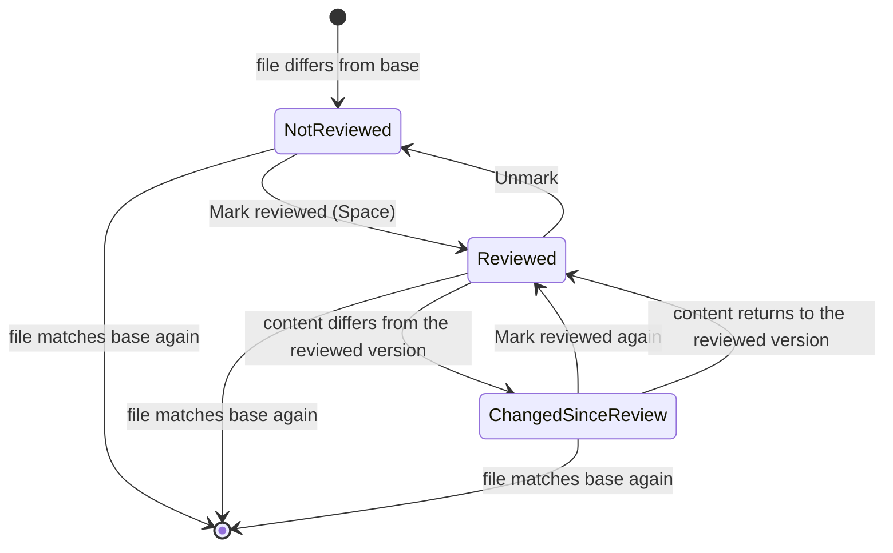

# Changes: review agent work, then ship

The Changes panel and its diff tabs become one review loop: a flat file list with review marks in the panel, one Review tab per worktree that stacks every diff, and a ship bar whose button always names the next step. Review marks remember the version you looked at, so an agent's later edit reopens only what's new.

This spec covers the `quirky.git` plugin's panel and diff views. The baseline it replaces is [current-state.md](current-state.md), with screenshots in [`img/current/`](img/current/).

Where this spec disagrees with the earlier source-control specs about the panel, diff tabs, note placement or the commit and remote controls, this one wins: [m2 source control core](../2026-10-27-m2-source-control-core/logic.md), [m2 notes and AI](../2026-10-27-m2-source-control-notes-ai/logic.md) and [m7 completion](../2026-10-28-m7-editor-source-control-completion/logic.md). Their git operations, conflict handling and AI defaults still hold.

## Why

Most of what lands in a worktree is written by an agent, so the job here is reviewing that work and shipping it. The panel today is built around staging. Above the first file sit a message box, a split button, a PR status line and two more buttons, so the first changed file starts about 400px down at 1280×720. Reviewing means opening per-file tabs, or one of three combined tabs ("unstaged", "branch", "all") that overlap and sometimes list the same file twice. Most actions appear only on hover, and nothing tracks which files you've already looked at. When the agent edits a file again, you re-read all of it.

The redesign answers two questions at a glance: what did this worktree change, and is it ready to ship. Staging stays possible but moves out of the way.

## What this replaces

| Today | After |
| --- | --- |
| Sections for Changes, Staged, Untracked and Committed on branch | One flat list of every file that differs from the base, in path order |
| Per-file, unstaged, branch, all and commit diff tabs | One Review tab per worktree; a commit opens in it with a scope chip |
| Commit box, split button, PR status line, Summarize and Commit, push & Create PR, all above the files | A ship bar pinned to the bottom of the panel, with one button named for the next step |
| Hover-only row and section actions | Actions on the selected row and in right-click; nothing depends on hover |
| NOTES shelf at the top of the panel | A note count on the row and the card, and "Send N notes to agent" in the ship bar |
| Errors inline and as a toast, with the inline error going stale | One error line above the ship button that clears on the next attempt |
| AI commit dialog on every run | ✦ generates straight away with the saved recipe |

## Conceptual model

### What a file's diff compares

Every diff in the Review tab compares the point where this branch left its base (the merge base with `main`, or whichever base the worktree uses) with what's on disk now. Committed and uncommitted changes fold into one diff per file, so each file appears once. Whether a change is committed, staged or neither doesn't change what you review. The panel still tells you which files have uncommitted edits, because that decides what Commit will take.

### Review marks

A review mark is your record that you looked at a file. Marking a file reviewed saves its content at that moment as the reviewed version. A file is in one of three states:

- Not reviewed (○): no reviewed version yet.
- Reviewed (✓): what's on disk matches the reviewed version.
- Changed since review (amber ●): what's on disk differs from the reviewed version. Its diff shows reviewed version → now, with a link to the full diff.

Only content counts. Commits, staging and rebases that leave the content alone leave the mark alone. Changes you make yourself in Quirky, a revert from the Review tab or a save in Quirky's editor, keep the file reviewed by moving the reviewed version to the new content. Every other write reopens it. Marks belong to Quirky and never stage, commit or block anything. They're kept per worktree across restarts, and changing the worktree's base clears them, because every diff changes with it.

### The panel

The panel stays in the right-top tool slot, and its header icons (filter, ⋯, minimize) still appear only while the panel has focus. Top to bottom:

1. The header line: branch → base chip (opens Change Base Ref) and +/− totals, such as `ui-review-ready → main +22 −2`.
2. A count line: `2 of 4 reviewed · 1 uncommitted`.
3. The file list, flat and in path order, so rows never move as you review. ⋯ switches it to a folder tree.
4. The collapsed Commits section.
5. The ship bar, pinned to the bottom.

A row shows, left to right: review mark, file icon, name, dimmed folder (cut from the left when long), compact +/− counts, note count, and status letter (M, A, D, R). A file with uncommitted edits shows a small dot before its status letter. The selected row also shows its actions inline (Revert, Open), and right-click lists every action: Open in Review, Open file, Mark reviewed, Revert file…, Stage or Unstage, Copy path, Copy relative path, Reveal in Finder.

The ⋯ menu holds List or Tree, Change base…, Refresh, Summarize branch with AI, and Revert all….

### The Review tab

Each worktree has at most one tab named Review. Its header reads `ui-review-ready vs main · 4 files · 2 reviewed`, with Collapse all, an inline or side-by-side toggle, and Word wrap and Show whitespace in ⋯. The body stacks one card per file in the panel's order. Each card header has the path, +/− counts, the note count and the review control. Reviewed files collapse; unreviewed and changed-since-review files stay open. Each change in a diff has its own ↶ Revert.

Clicking a row in the panel scrolls the Review tab to that file, opening the tab if needed. The tab picks its layout by width: inline when the center is narrower than about 900px, side-by-side when it's wider. The toggle overrides that until the tab closes.

A commit opened from the Commits section shows in the same tab, scoped to that commit, with a chip such as `Commit f5429a1 ×`. In that scope the cards show the commit's own diff and no review controls. Removing the chip goes back to the worktree review.

### The ship bar

The ship bar holds, top to bottom: "Send N notes to agent ▾" when notes exist, the message field while there's something to commit, the error line when the last step failed, and the ship button with its caret. ✦ is a clickable button at the right end of the message field. The button names the next step, worked out from the worktree's state (the table is under scenario 22). The caret lists every other step, and a step that can't run stays in the list, greyed, with its reason.

## Behavior and scenarios

### Reviewing

1. **An agent finishes a turn**
   - **Given** the Changes panel shows nothing for **Worktree "ui-review-ready"**
   - **When** the agent finishes a turn that changed 4 files
   - **Then** ✓ the panel lists 4 rows with ○; ✓ the count line reads "0 of 4 reviewed"; ✓ the Review tab, if open, stacks all 4 cards expanded
   - **Data before:** **Panel**: "Nothing changed against main"
   - **Data after:** **Panel**: ✓ README.md\*, src/app.ts\*, src/feature/enabled.ts\*, src/feature/flags.ts\*, each ○; **Count line**: ✓ "0 of 4 reviewed · 4 uncommitted"
2. **The first file is visible without scrolling**
   - **Given** the window is 1280×720 with both tool slots open and the worktree has changes
   - **When** the user opens the Changes panel
   - **Then** ✓ the first file row is visible without scrolling; ✓ only the panel title, the header line and the count line sit above it
3. **Opening the Review tab from different places**
   - **Given** **Worktree "ui-review-ready"** has a Review tab open on src/app.ts
   - **When** the user clicks the flags.ts row, then runs "View All Changes" from the palette, then opens a commit from the Commits section
   - **Then** ✓ each action reuses the same Review tab; ✓ the worktree never has more than one Review tab; ✓ the commit shows with a scope chip
   - **Data before:** **Center tabs**: Terminal 1, Review
   - **Walkthrough:**
     1. The user clicks the flags.ts row; Review scrolls to flags.ts
     2. The user runs "View All Changes"; Review scrolls to the top of the stack
     3. The user opens commit f5429a1\*; Review shows that commit with the chip `Commit f5429a1 ×`
   - **Data after:** **Center tabs**: ✓ Terminal 1, Review
4. **Marking a file reviewed**
   - **Given** src/feature/enabled.ts is selected and not reviewed
   - **When** the user presses Space in the panel, or clicks "Mark reviewed" on its card
   - **Then** ✓ its row shows ✓; ✓ its card collapses; ✓ the count goes up by one; ✓ the panel selection and the Review tab move to the next file in path order that's still ○ or ●, skipping reviewed files; ✓ if none is left, the selection stays put
   - **Data before:** **Count line**: "2 of 4 reviewed"; **Panel selection**: enabled.ts; **flags.ts**: ● changed since review
   - **Data after:** **Count line**: ✓ "3 of 4 reviewed"; **enabled.ts card**: ✓ collapsed, "✓ Reviewed"; **Panel selection**: ✓ flags.ts; **Review tab**: ✓ scrolled to flags.ts
5. **The agent edits a file you already reviewed**
   - **Given** src/feature/flags.ts is reviewed
   - **When** the agent adds a line to it
   - **Then** ✓ its row shows amber ●; ✓ its card expands and shows only what changed since the reviewed version, with a "Full diff" link; ✓ the count goes down by one
   - **Data before:** **flags.ts**: ✓ reviewed at 1 line\*
   - **Walkthrough:**
     1. The agent writes `export const defaultFlags: Flag[] = []` to flags.ts
     2. Quirky sees the content differs from the reviewed version
   - **Data after:** **flags.ts**: ✓ ● changed since review; **flags.ts card**: ✓ "Showing 1 change since you reviewed · Full diff"
6. **The content goes back to what you reviewed**
   - **Given** flags.ts is changed since review
   - **When** the agent undoes its new edit, leaving the file as it was when reviewed
   - **Then** ✓ the row shows ✓ again with no action from the user
7. **The agent commits, stages or rebases without changing content**
   - **Given** 3 of 4 files are reviewed, 4 are uncommitted, and the branch has no upstream
   - **When** the agent commits all 4 files
   - **Then** ✓ all marks stay as they were; ✓ the uncommitted count drops to 0; ✓ the ship button changes from Commit to the next step
   - **Data before:** **Count line**: "3 of 4 reviewed · 4 uncommitted"; **Ship button**: "Commit 4 files"
   - **Data after:** **Count line**: ✓ "3 of 4 reviewed"; **Ship button**: ✓ "Publish branch"
8. **Reverting a change from the Review tab**
   - **Given** src/app.ts is reviewed and has 2 changes
   - **When** the user clicks ↶ Revert on one change and confirms
   - **Then** ✓ the change is undone on disk; ✓ app.ts keeps its ✓, because the reviewed version moves to the reverted content; ✓ if the revert leaves the file matching the base, its row goes away
   - **Data before:** **app.ts**: ✓ reviewed, +10 −2
   - **Data after:** **app.ts**: ✓ reviewed, +6 −0\*
9. **Reverting a change that's already committed**
   - **Given** a change in README.md is committed on the branch
   - **When** the user reverts it from the Review tab and confirms
   - **Then** ✓ the base version of those lines is written to disk as an uncommitted edit; ✓ README.md gains the uncommitted dot; ✓ the next commit carries the undo
10. **You edit a reviewed file yourself**
    - **Given** src/app.ts is reviewed
    - **When** the user changes it in Quirky's editor and saves
    - **Then** ✓ app.ts keeps its ✓, because the reviewed version moves to the saved content; ✓ a later edit by the agent, a terminal command or another editor reopens it as usual
    - **Data before:** **app.ts**: ✓ reviewed, +10 −2
    - **Walkthrough:**
      1. The user fixes a typo on one line and saves in Quirky's editor
      2. Quirky records the saved content as the reviewed version
      3. The agent later rewrites another line in app.ts
    - **Data after:** **app.ts** after step 2: ✓ reviewed, +10 −2; **app.ts** after step 3: ✓ ● changed since review, showing only the agent's line
11. **The agent deletes a file**
    - **Given** src/legacy.ts\* exists on the base
    - **When** the agent deletes it
    - **Then** ✓ its row stays with status D and ○ until the user reviews the deletion; ✓ its card shows the removed lines
12. **Changing the base clears marks**
    - **Given** 3 files in the worktree are reviewed
    - **When** the user picks a different base in Change Base Ref
    - **Then** ✓ the dialog says "This clears 3 review marks" before the user confirms; ✓ after confirming, every row shows ○ and every diff compares against the new base
13. **Restarting Quirky**
    - **Given** 3 of 4 files are reviewed
    - **When** the user quits and reopens Quirky
    - **Then** ✓ the same 3 files are reviewed in that worktree
14. **A file changed both in commits and on disk**
    - **Given** flags.ts was committed on the branch and then edited again without committing
    - **When** the user looks at the panel and the Review tab
    - **Then** ✓ flags.ts appears once in each, with one diff from the base to what's on disk; ✓ its row shows the uncommitted dot
15. **The center gets narrower**
    - **Given** the Review tab is open in a 1600px\* window, showing side-by-side
    - **When** the user shrinks the window until the center is under about 900px
    - **Then** ✓ the diffs switch to inline; ✓ if the user had picked a layout with the toggle, that choice holds until the tab closes

### Rows and the panel

16. **Selecting a row**
    - **Given** no row is selected
    - **When** the user clicks the enabled.ts row
    - **Then** ✓ that row shows Revert and Open inline; ✓ every other row shows no buttons; ✓ the Review tab scrolls to enabled.ts
17. **Right-clicking a row**
    - **Given** any row
    - **When** the user right-clicks it
    - **Then** ✓ a menu lists Open in Review, Open file, Mark reviewed (or Unmark), Revert file…, Stage (or Unstage), Copy path, Copy relative path and Reveal in Finder
18. **Using only the keyboard**
    - **Given** the panel has focus
    - **When** the user presses ↓, Enter, Space, then ⌫
    - **Then** ✓ ↓ selects the next row; ✓ Enter opens it in Review; ✓ Space marks it reviewed and moves to the next unreviewed file, as in scenario 4, or unmarks it and stays if it was already reviewed; ✓ ⌫ starts "Revert file…" with its confirm; ✓ ⌘⇧G, F7, ⇧F7 and ⌘⇧A keep working as today
19. **Reverting everything**
    - **Given** the worktree has 4 changed files
    - **When** the user looks for a way to discard all of them
    - **Then** ✓ the only bulk revert is "Revert all…" in the ⋯ menu; ✓ its confirm reads "Revert all 4 files?"; ✗ no row or header has a bulk discard button
20. **Adding and sending review notes**
    - **Given** no notes exist
    - **When** the user adds two notes on lines in app.ts, then clicks "Send 2 notes to agent ▾"
    - **Then** ✓ app.ts's row shows ✎2 and its card shows "✎ 2 notes"; ✓ "Send 2 notes to agent ▾" appears above the message field; ✓ its menu lists the worktree's live agent sessions and "New agent tab"; ✓ the panel has no notes shelf
    - **Data before:** **Ship bar**: message field, ship button
    - **Data after:** **Ship bar**: ✓ "Send 2 notes to agent ▾", message field, ship button
21. **Finding the note control without a mouse**
    - **Given** a screen reader or keyboard user is in a diff
    - **When** they move to a line
    - **Then** ✓ the add-note control is in the accessibility tree with the name "Add note on line 12"\*

### Shipping

22. **The ship button names the next step**
    - **Given** any worktree with changes or unpushed commits
    - **When** the user looks at the ship bar
    - **Then** ✓ the button reads the first step in the table below that applies
    - **Ship button states:**

      | When (first that applies) | Button |
      | --- | --- |
      | Uncommitted changes, some staged by hand | `Commit 2 staged files` |
      | Uncommitted changes | `Commit 3 files` (new files included) |
      | Branch is behind its upstream and not ahead | `Pull 2 commits` |
      | Branch is both ahead of and behind its upstream | `Sync` |
      | Branch has no upstream | `Publish branch` |
      | Commits not yet pushed | `Push 4 commits` |
      | Pushed to a GitHub remote, no PR, and the branch isn't the base | `Create PR` |
      | A PR is open for the branch | `View PR #12` (opens it in Reviews) |
      | Nothing differs from the base and nothing to push | No ship bar (scenario 30) |

23. **From review to an open PR**
    - **Given** the user has reviewed all 4 files; 1 file is uncommitted; the branch has no upstream; the remote is on GitHub
    - **When** the user writes or generates a message and follows the ship button
    - **Then** ✓ it takes at most four clicks: Commit, Publish branch, Create PR, then Create in the existing PR form
    - **Data before:** **Ship button**: "Commit 1 file"
    - **Walkthrough:**
      1. The user clicks ✦; the message fills in
      2. The user clicks "Commit 1 file"; the button becomes "Publish branch"
      3. The user clicks "Publish branch"; the button becomes "Create PR"
      4. The user clicks "Create PR"; the PR form opens in Reviews
      5. The user clicks Create in the form; the PR opens as #12\*
    - **Data after:** **Ship button**: ✓ "View PR #12"
24. **Hand-staged files are respected**
    - **Given** 3 files are uncommitted and the user staged 2 of them from right-click
    - **When** the user looks at the ship bar and opens the caret
    - **Then** ✓ the button reads "Commit 2 staged files"; ✓ the 2 staged rows show a filled uncommitted dot; ✓ the caret offers "Commit all 3 files"
25. **Committing only some files**
    - **Given** 3 files are uncommitted and none are staged
    - **When** the user picks "Commit selected files…" from the caret, unticks one row and commits
    - **Then** ✓ rows show checkboxes, all ticked; ✓ the button reads "Commit 2 of 3 files"; ✓ after the commit, or on Escape, the checkboxes go away
26. **Committing without a message**
    - **Given** the message field is empty and there are uncommitted changes
    - **When** the user clicks "Commit 3 files"
    - **Then** ✗ nothing is committed; ✓ the error line reads "Write a commit message, or click ✦"; ✓ the message field takes focus
27. **Generating the message**
    - **Given** a saved AI commit recipe uses Claude\*
    - **When** the user clicks ✦ at the right end of the message field
    - **Then** ✓ the message fills in without a dialog; ✓ a note under the field reads "Written by Claude"; ✓ the ✦ menu offers "Choose agent…"
28. **A step that can't run**
    - **Given** the worktree has no GitHub remote
    - **When** the user opens the caret
    - **Then** ✓ "Create PR" is greyed with the reason "no GitHub remote"; ✓ "Pull" is greyed with "no upstream yet" when the branch hasn't been published; ✗ no standing banner says the remote is missing
29. **A step fails**
    - **Given** the branch has 4 unpushed commits and the remote has new commits that Quirky hasn't fetched yet
    - **When** the user clicks "Push 4 commits"
    - **Then** ✓ one line above the button reads "Push rejected: the remote has new commits · Pull first ×"; ✗ no toast appears; ✓ the line clears on the next attempt or on ×
30. **Nothing to review**
    - **Given** the worktree matches its base and is up to date with its upstream
    - **When** the user opens the panel
    - **Then** ✓ the panel shows one line, "Nothing changed against main · up to date with origin/main", then the collapsed Commits section; ✗ no ship bar, message field or disabled buttons
31. **Unpushed commits with nothing to review**
    - **Given** the main worktree is on `main` with 2 commits not yet pushed
    - **When** the user opens the panel
    - **Then** ✓ the ship bar shows "Push 2 commits"; ✓ "Create PR" stays greyed in the caret with "this is the base branch"
32. **A merge with conflicts**
    - **Given** a merge stopped with 1 conflicted file
    - **When** the user opens the panel
    - **Then** ✓ the conflict card takes the ship bar's place with today's Review conflicts, Resolve with AI and Abort merge; ✓ the conflicted row shows a conflict status; ✗ no "1 conflict(s)" chip repeats the count
33. **Opening a commit from history**
    - **Given** the Commits section is expanded
    - **When** the user clicks commit f5429a1\*
    - **Then** ✓ the Review tab shows that commit's files with the chip `Commit f5429a1 ×` and no review controls; ✓ removing the chip returns to the worktree review

## How we know it's done

All four hold, checked against the whole change before it lands:

1. At 1280×720 with both tool slots open, the first changed file is visible in the panel without scrolling.
2. A worktree never has more than one Review tab, whatever opened it: a row, the palette, history or a note.
3. From an agent finishing to an open PR takes the review itself, a commit message (typed or ✦), and at most four clicks: Commit, Push or Publish, Create PR, then Create in the existing PR form.
4. The redesigned panel and Review tab score at least 85 in the existing screenshot review, in dark and in light.

## Rollout

Everything ships in one release, with no setting to switch back. Because it lands at once, the screenshot review and a click-through of the walkthrough's twelve goals (using `using-apps-like-a-user`) run against the whole change before it merges, not one piece at a time. The research behind this guard is under Industry Insights.

## Scope and non-goals

In scope: the Changes panel, the single Review tab (replacing the file, unstaged, branch, all and commit diff tabs), review marks, where review notes show and how they're sent, the ship bar and its steps, the clean, error and limit states, row anatomy and the context menu, the keyboard, and the walkthrough bugs those surfaces own.

Out of scope, with today's design kept:

- Conflict resolution, apart from the duplicate count chip (scenario 32). Accept buttons and the rest are under Deferred Ideas.
- The Commits section's own design. It only changes to open commits in the Review tab.
- The Source Control AI defaults form.
- The PR form in Reviews.
- The git operations underneath. Review marks are new, but they're Quirky's own record, not git state.

Rules that still hold: the panel stays in the right-top slot with focus-revealed header icons, and new visual needs become shared `@quirky/ui` components with shared tokens rather than plugin-private styling.

## Decisions Locked

### Purpose and scope

- The panel is for reviewing agent work and then shipping it. Staging stays available but secondary.
- The redesign covers the review loop: panel, diff views (file, combined, branch, commit), notes and the ship step. Conflicts, history and AI settings get bug fixes only.
- Review features are added; the git operations underneath stay the same.
- Kept from today: the right-top slot and focus-revealed panel controls.
- Success criteria are the four under "How we know it's done". "Every action findable without hover" was offered as a criterion and not picked; row actions are still reachable without hover by the row-actions decision below.

### Layout

- The panel navigates and the center stacks every diff in one Review tab per worktree.
- Each file's diff compares the base with what's on disk, and each file appears once.
- Inline or side-by-side is picked automatically by width, inline below about 900px, with a toggle that holds until the tab closes.
- The file list is one flat list in path order. This was the user's choice; I had recommended "To review" and "Reviewed" groups.
- A row shows review mark, icon, name, dimmed folder, compact +/− counts, note count and status letter.
- Review marks always show; actions appear on the selected row and in right-click.

### Review state

- Marking a file reviewed records its content; an edit that changes the content reopens just the new part.
- Marks persist per worktree across restarts, deleted files need review like any change, and changing the base clears marks.
- Untracked files are ordinary changed files with status A.
- Marking a file reviewed moves the selection and the Review tab to the next unreviewed file. This was settled at spec review.
- Your own saves in Quirky's editor keep a file reviewed, as reverts from the Review tab do. This was settled at spec review.

### Shipping

- One button named for the next step, with every other step in the caret and the reason shown for any that can't run.
- Commit takes everything uncommitted, with "Commit selected files…" in the caret and hand-staged files respected.
- Errors show once at the ship bar until the next attempt. Limits appear only as reasons in the caret.
- Notes show as counts on rows and cards and are sent from the ship bar.
- ✦ generates the message with the saved recipe and names the agent; "Choose agent…" is in its menu.
- ✦ is a clickable button at the right end of the message field. This came from the user's note on design section 3.

### Smaller defaults, accepted together

- Review tab, its header, the panel header, keyboard, revert safety, AI commit message, ship steps, review marks, new files, history and the walkthrough bugs, as written in the Conceptual model and scenarios above.

### Delivery

- Everything ships in one release. This was the user's choice; I had recommended two slices, layout first and review marks second.

### Assumed while writing the spec

These weren't asked directly. Each is my reading of a locked decision, and each can be changed at review.

- When the branch is behind or has diverged from its upstream, the ship button reads "Pull N commits" or "Sync" (scenario 22).
- A small dot before the status letter marks a file with uncommitted edits, filled when the file is staged by hand (scenarios 14 and 24).
- Change Base Ref warns how many review marks it will clear (scenario 12).
- A commit opened from history shows no review controls (scenario 33).
- During a merge, today's conflict card takes the ship bar's place (scenario 32).
- An empty message blocks Commit with an error line rather than disabling the button (scenario 26).

## Industry Insights

Research ran on 2026-11-02, in two rounds: patterns and anti-patterns for git review UIs, then experience with three delivery approaches.

### Patterns that shaped the design

- GitHub's Files changed page (default since January 2026) pairs a file tree that marks files with comments with one stacked diff, and hides the tree on narrow screens. https://github.blog/changelog/2026-01-22-improved-pull-request-files-changed-page-on-by-default/
- Zed opens a diff scoped to the section you clicked, and reuses diff tabs rather than opening duplicates. https://github.com/zed-industries/zed/pull/61507, https://github.com/zed-industries/zed/pull/56152
- Zed users ask to review agent edits per turn, which a merged staged and unstaged diff blocks; the maintainers treat the merge as intentional. https://github.com/zed-industries/zed/discussions/64531
- Cursor users complain when agent edits land with no review step, and ask for per-change and per-file accept. https://forum.cursor.com/t/bring-back-per-change-apply-inline-diff-review-you-re-throwing-away-your-best-ux-advantage/160856
- JetBrains made non-modal commit the default in 2025.1, and users call it cluttered and less keyboard-friendly. https://youtrack.jetbrains.com/projects/IJPL/issues/IJPL-177161
- I found no shipped dev tool with a per-file review mark that reopens on edit. The closest is GitHub's "Viewed" checkbox on PR files, which I know from general knowledge rather than a source found here.

### Anti-patterns the design avoids

- Hover-only actions are invisible to keyboard and touch users and get clipped in narrow panels; Git Graph moved them to a context menu. https://github.com/mhutchie/vscode-git-graph/issues/381
- "Discard All" next to a single-file discard loses work on one misclick. https://github.com/desktop/desktop/issues/4423
- Pull and Push enabled when they'll fail, or a label left stale after an error. https://github.com/github/app/issues/1455, https://github.com/desktop/desktop/issues/6767
- Side-by-side diffs below about 900px; Gerrit switches to unified there. https://gerrit.googlesource.com/gerrit/+/74f531c6a698354f067e9934c2b82b85f14703a2%5E%21/polygerrit-ui/app/elements/diff/gr-diff-view/gr-diff-view.js
- AI commit buttons that hide which model, quota or prompt they use. https://github.com/microsoft/vscode/issues/273271

### Delivery

- An AI-driven rewrite of a whole UI passed its unit tests but broke layouts and interactions in the running app. It was rolled back and redone one module at a time with visual checks. https://typeflux.app/blog/ai-full-ui-refactor-rollback/
- Sonos replaced its app in 2024 with no fallback and missing features. https://appleinsider.com/articles/24/08/21/sonos-ceo-insists-ios-app-cannot-be-rolled-back-to-the-older-better-one
- GitHub, Figma, JetBrains and VS Code all ran old and new side by side before removing the old UI. Figma found a slow layout and an accessibility regression only once people used the beta. https://www.figma.com/blog/our-approach-to-designing-ui3/
- The loudest complaint after VS Code's 2026 redesign was density, fixed afterwards with a compact mode. https://code.visualstudio.com/blogs/2026/10/15/modern-ui
- Visual changes and behavior changes carry different risk and deserve separate justification. https://expdyn.medium.com/incremental-vs-big-bang-redesigns-evaluating-design-changes-for-users-2cb15dea05a4

The whole-change screenshot review and click-through under Rollout answer the first and third findings, since this change ships at once.

## Deferred Ideas

- Conflict resolution: accept current, incoming or both, with the order of "both" stated (https://github.com/orgs/community/discussions/175270).
- Conflict labels that name the branches instead of "current" and "incoming", which flip meaning between merge and rebase (https://github.com/microsoft/vscode/issues/112600).
- A common-ancestor view for conflicts (https://github.com/microsoft/vscode/issues/133088).
- A redesign of the Commits section.
- A redesign of the Source Control AI defaults form, and its view strip that persists across worktree switches.
- Line-level staging and a three-way merge view.
- `[tech-spec]` How reviewed versions are stored and kept per worktree, and when they're pruned.
- `[tech-spec]` How Quirky tells its own reverts and editor saves apart from other writes to a file, including a save that races an agent's write.
- `[tech-spec]` How the reviewed version → now diff is computed, and how the merge base is found and refreshed.
- `[tech-spec]` Which `@quirky/ui` components to add: review mark, stacked diff card, ship button with reasons, scope chip.
- `[tech-spec]` How the panel and Review tab behave when git status is capped on a very large change.

## Glossary

- Base: the branch a worktree is compared with, `main` unless changed in Change Base Ref.
- Merge base: the commit where the branch left its base. Diffs start from here.
- Review tab: the one center tab per worktree that stacks every changed file's diff.
- Review mark: ○, ✓ or amber ●, showing whether you've reviewed a file's current content.
- Reviewed version: the file content saved when you marked it reviewed.
- Changed since review: the file on disk differs from its reviewed version.
- Ship bar: the area pinned to the bottom of the panel with notes, the error line, the message field and the ship button.
- Next step: the step the ship button names, taken from the table under scenario 22.
- Scope chip: the removable chip in the Review tab header that narrows it to one commit.
- Uncommitted: a file with edits on disk or in the index that aren't in a commit yet.

## Status & amendments

Status: Approved 2026-11-02.
