# Chat input: current state

Walked 2026-11-16 in the real Quirky preview build (`dev.quirky.app.preview`, from the `sdd-chat1/preview` checkout), dark, with Worktrees and Ask open, on a Claude session in its `demo-repo` sandbox. The fixture can't start a chat session, so nothing was walked there. Screenshots are the native window at 2992x1876, not the usual 1280x720.

## Where things live

- **Composer**: under the transcript in the Structured session view (`view:quirky.session/structured`), in `plugins/quirky.session/src/window/chat/Composer.tsx`. It has a two-row resizable textarea with a Send button to its right. Send reads Queue while the agent works.
- **Footer controls**: below the textarea, in `chat/controls.tsx`. Left to right: the agent chip, labelled native selects for Model, Effort and Permission mode, a Plan mode button, and a + Attach images icon button. The elapsed timer and Stop sit at the far right while the agent works.
- **Queued messages**: a strip above the textarea (`chat/QueuedList.tsx`), one row per message with Edit, Delete and Steer now.
- **@ mention list**: typing `@` opens a Files list (`chat/Mentions.tsx`). It renders above the queued strip.
- **Attached images**: chips above the textarea. Images can only arrive by drop or paste.
- **Ended session**: the textarea and controls are replaced by a muted "session ended" line.
- **Layout toggle**: the square icon button at the bottom right of the composer comes from the surrounding view, not the composer.

## The walk

### g1: Write a two-line message and send it

Result: partial. Shift+Enter gave a second line and Send delivered both lines. Claude replied "OK", and the message already in the queue ran next as its own turn. It's recorded as partial only because the Send action came back `UNSETTLED` while the reply streamed, so likeuser had no `OBSERVED` effect to accept.

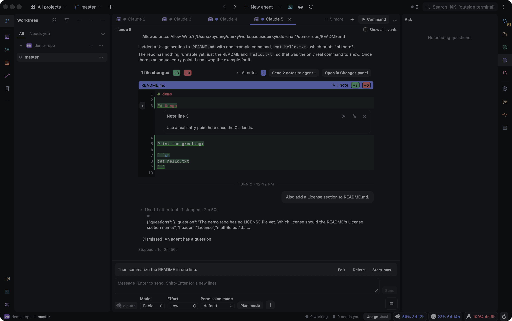
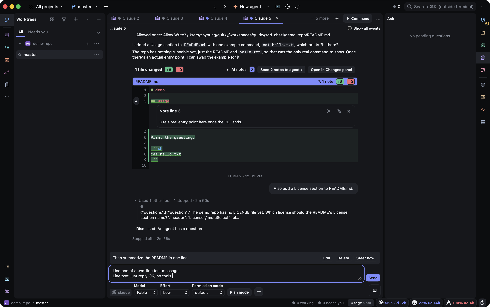
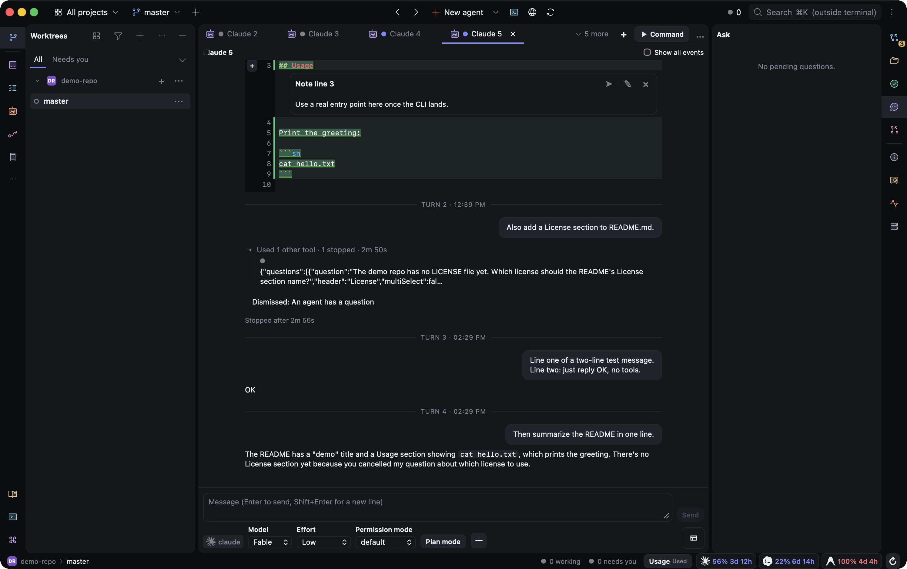

### g2: Queue a follow-up while the agent works, then stop the turn

Result: pass. While a long reply streamed, the placeholder changed to "Queue a message…", the button read Queue, and a timer appeared. Enter moved the follow-up into the queued strip. Stop ended the turn ("Stopped after 47s") and the queued message stayed held rather than sending. Stop is almost entirely hidden under the layout toggle (see Bugs).

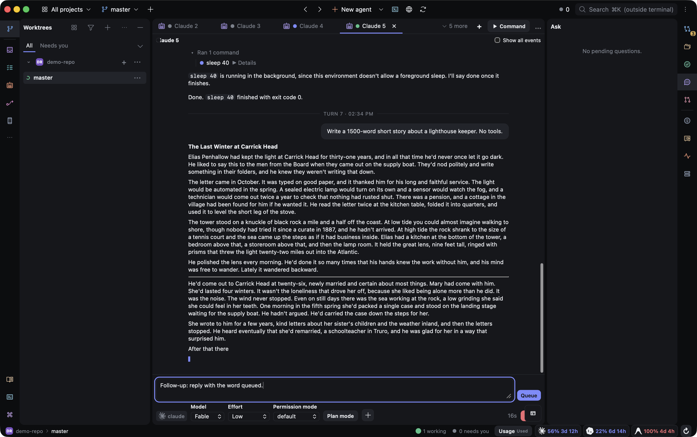
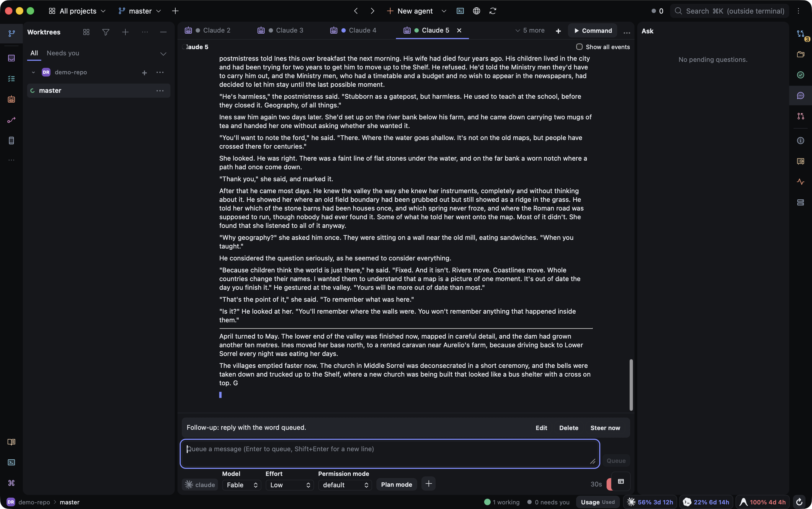
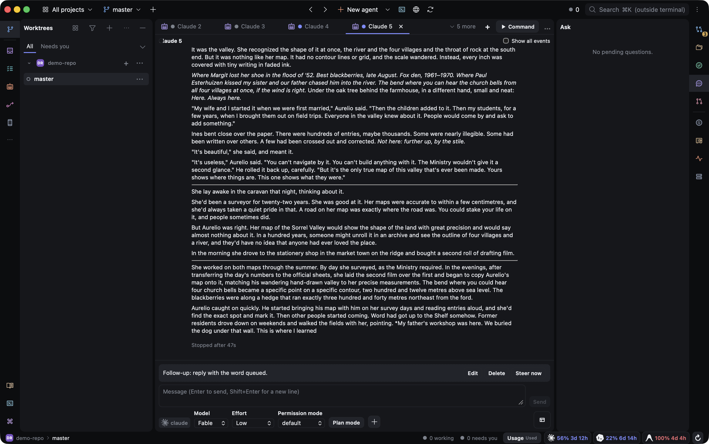

### g3: Mention a file with @ and pick it from the list

Result: pass. Typing `@REA` opened a Files list with README.md selected, and Tab inserted `@README.md`. The list renders above the queued strip, away from the caret, and the mention lands as plain text.

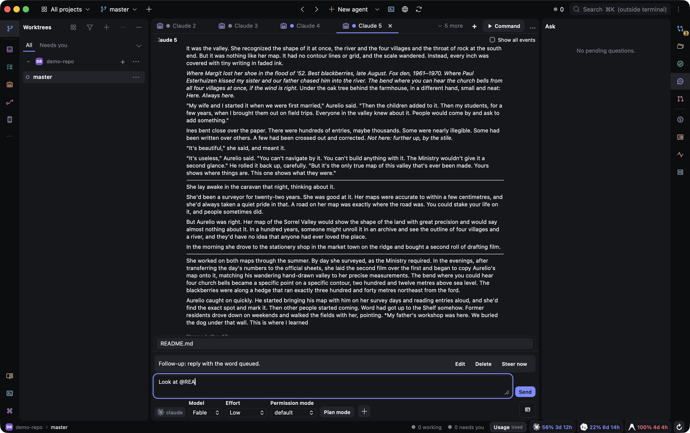
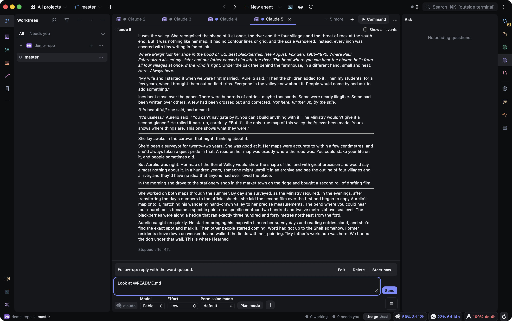

### g4: Attach an image, then remove it before sending

Result: fail. The + button opens no picker; it only toasts "Drop images onto the composer". Pasting a PNG copied from Finder fails with "Could not attach: … has no file path". Drag from Finder wasn't tried because the driver can't drag between apps reliably. No chip appeared, so removing one was never reached.

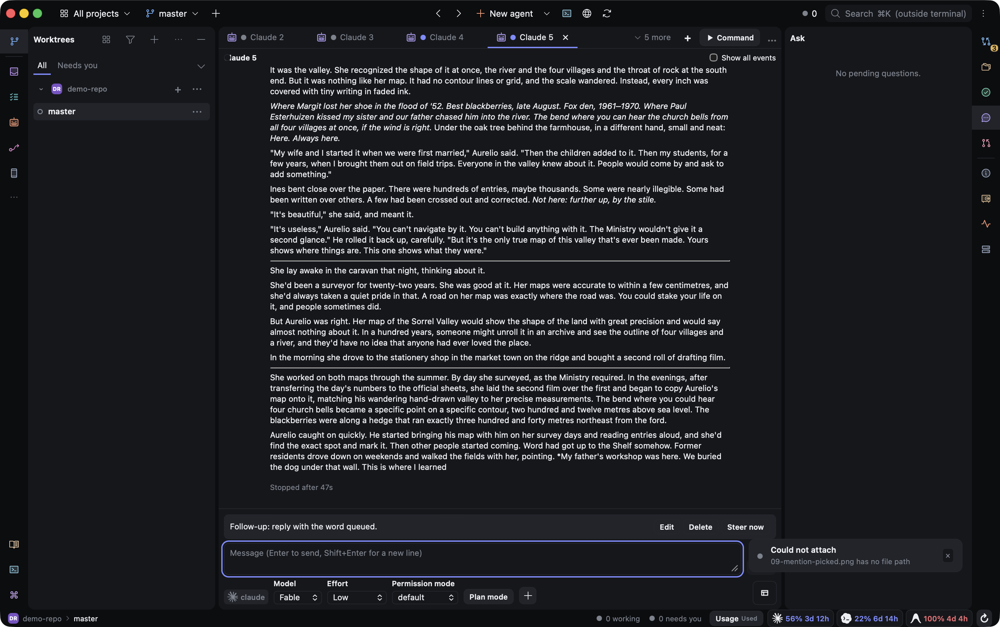

### g5: Switch model and effort, change permission mode, turn on plan mode

Result: pass. The native menus changed Model (Fable to Opus), Effort (Low to Medium) and Permission mode (default to acceptEdits), and Plan mode toggled on. The menus took keyboard input only, because pointer clicks didn't reach the open native popup. Plan mode on looks the same as off. Everything was set back afterwards.

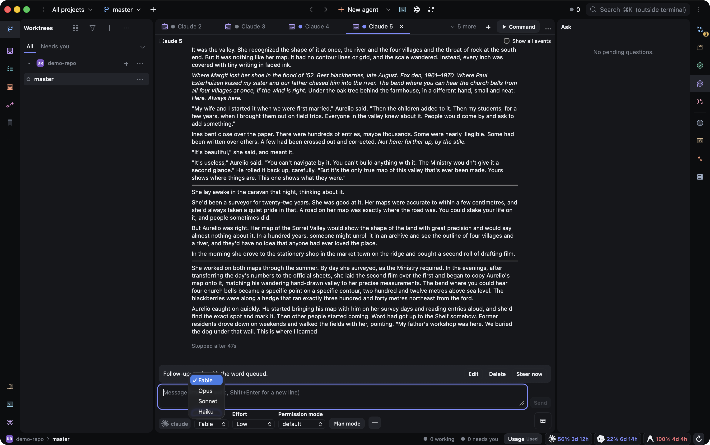
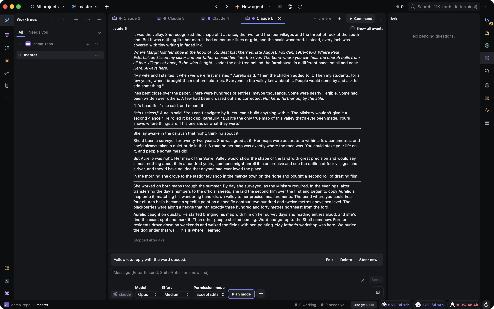

### g6: See what the composer shows once the session has ended

Result: pass. An exited session shows a muted "session ended" line in place of the composer, with no way to resume or start a new chat from there. A queued message left over from that session still offers Edit, Delete and Steer now.

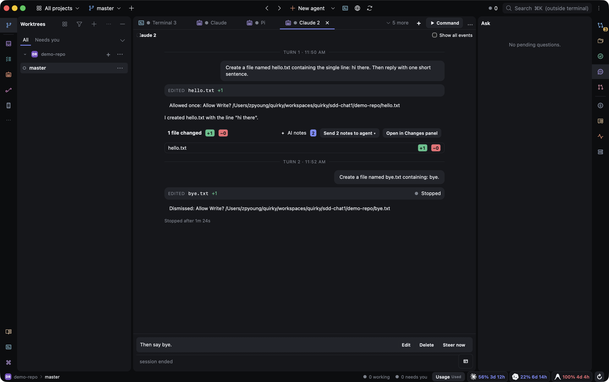

## Capabilities

| Capability | Where it lives |
|---|---|
| Type a message, Shift+Enter for a new line | textarea |
| Send with Enter or the Send button | textarea, Send button |
| Queue while working (Enter or Queue button) | textarea, Send/Queue button |
| Edit, delete or steer a queued message | queued strip rows |
| Stop the running turn | Stop button, bottom right, working state only |
| Elapsed time of the running turn | timer beside Stop |
| Mention a file: `@`, arrows, Enter/Tab to pick, Esc to close | Files list above the queue |
| Attach images by drop or paste; remove a chip | composer drop target, chips above textarea |
| Attach hint | + button toast |
| Choose model (built-in plus live models) | Model select |
| Choose effort | Effort select |
| Choose permission mode | Permission mode select |
| Toggle plan mode | Plan mode button |
| See which agent the session uses (fixed) | agent chip |
| Disabled controls explain why on hover | `title` on each control from agent capabilities |
| Failed send restores the draft and images | toast "Could not send" |
| Ended state | "session ended" line |
| Resize the textarea | drag handle |

## Bugs

- Stop is covered by the layout toggle button in the working state, so only a red sliver shows beside the timer. Screenshot: img/current/04-working-queue-draft-stop-hidden.png. Cause: the composer's footer `running` span sits under the view's layout toggle at the bottom right (`plugins/quirky.session/src/window/chat/Composer.tsx:265`). The overlapping toggle's source wasn't found.
- Pasting an image file never attaches: "has no file path". Screenshot: img/current/11-paste-image-no-file-path.png. Cause: `absolutePathsOf` (`plugins/quirky.session/src/window/chat/controls.tsx:112`) gets paths from `File.path` or `context.nativeDropPaths`, and neither covers a paste. A raw screenshot pasted from the clipboard has no path either.
- Plan mode has no visible on state. Only `aria-pressed` changes. Screenshot: img/current/13-controls-changed-plan-on.png. Cause: the plain `Button` in `controls.tsx:200` gets no pressed styling.
- A queued message on an ended session still offers Steer now and Edit. Screenshot: img/current/14-session-ended.png. Cause: `Composer.tsx:208` renders `QueuedList` unchanged in the exited branch.
- Outside the composer: a reply asked for "one per line" rendered as a single paragraph, because the transcript collapses single newlines. Screenshot: img/current/07-one-per-line-collapsed.png. Cause: not found (transcript prose rendering, `chat/Prose.tsx`).

## Design themes

- The composer is a stack of separate strips: queued messages, mention list, chips, textarea, then a footer of form controls. It reads like a settings form under a text box, not one input.
- Model, Effort and Permission mode are labelled native selects that take a full row of their own. They open OS menus that pointer automation can't reach, and they look different from the rest of the UI.
- The + icon suggests a file picker but only shows a hint, and attaching works only by drop, since paste is broken. Attaching can't be discovered from the composer.
- The working state is easy to miss. Stop is hidden, the timer sits far right, and the only other signal is the button text changing from Send to Queue.
- Send is a separate button beside the textarea instead of living inside the input.
- The mention list and queued strip render above the textarea, far from the caret, so it's unclear which one the keyboard is driving.
- The ended state is a dead end: no resume, no new chat, and leftover queue actions that can't run.
- Toggle state (Plan mode) is invisible, and disabled-control reasons appear only on hover.
- Mentions insert plain `@path` text with no chip, so there's nothing to remove or check at a glance.

## Before scores

| Surface | Dark | Light |
|---|---|---|
| Structured session | 41 | 41 |

Read these from `scores/before.json`. The reviewer compared the whole app shell against the golden shell reference (panel gaps, sidebar selection, tab and status-bar styling) and barely looked at the composer. The full `quirky.session` review failed on capture because the Chat dialogs overlay is empty when no dialog is open, so only the Structured session view was scored.

## Goals not walked

none
