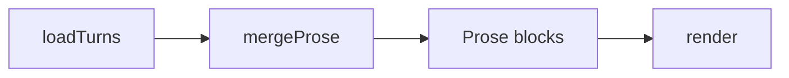

# Session reload drops partial replies

The reload path in `chat/turns.ts:119` replaces partial prose items instead of merging them, so `mergeProse()` never sees the tail. See the [original chat PR](https://github.com/zpyoung/quirky/pull/637) for how partial items were meant to work.[^1]

> [!WARNING]
> Sessions saved before this fix still have the truncated reply on disk. Reloading won't recover them.

> [!TIP]
> Press <kbd>⌘</kbd> <kbd>R</kbd> in the transcript to reload and check the fix yourself.

## What changed

- [x] Merge partial items on reload
- [x] Add a regression test for mid-stream reloads
- [ ] Backfill sessions saved before the fix

```ts title=turns.ts
export function mergeProse(prev: ProseItem[], next: ProseItem) {
  const last = prev.at(-1)
  // a partial item is replaced only by its own completion
  if (last?.partial && last.id === next.id) {
    return [...prev.slice(0, -1), next]
  }
  if (last?.partial) return [...prev, next]
  return [...prev, { ...next, partial: false }]
}
export const RELOAD_GRACE_MS = 250
```

```diff
  const items = loadTurns(session)
- return items.filter(i => !i.partial)
+ return items.reduce(mergeProse, [])
```

```ts title=reload.test.ts
import { describe, expect, test } from 'bun:test'
import { mergeProse } from '../src/window/chat/turns'
const GRACE_MS = 250

describe('reload mid-stream', () => {
  test('keeps the partial tail', () => {
    const prev = [{ id: 'p1', text: 'The bug is', partial: true }]
    const out = mergeProse(prev, { id: 'p1', text: 'The bug is in turns.ts' })
    expect(out).toHaveLength(1)
  })
  test('appends a new item after a partial one', () => {
    // ...
  })
  test('marks completed items final', () => {
    // ...
  })
  test('survives a reload during a tool call', () => {
    // ...
  })
  test('drops nothing when the session is idle', () => {
    // ...
  })
})
```

### Test results

| Test | Result | Time |
| --- | --- | --- |
| keeps the partial tail | ✓ pass | 4 ms |
| appends a new item after a partial one | ✓ pass | 2 ms |
| survives a reload during a tool call | ✓ pass | 31 ms |
| drops nothing when the session is idle | ✗ fail | 6 ms |

## How a reload flows now



Merging is a single fold, so reload cost is $O(n)$ in the number of items, and a $5 or $10 price in prose stays text.

$$
T_{reload} = \sum_{i=1}^{n} c_{merge}(item_i) \approx n \cdot 0.4\,\mu s
$$

<details>
<summary>Why not keep partial items out of the saved file?</summary>

Saving them is what lets a crash mid-reply recover the text. Dropping them would trade one data-loss bug for another. ==The merge keeps both.==

</details>

#### Session sizes

```csv title=session-sizes
session,items,partial,reload_ms
brain-chat,"1,284",3,11
avatar-pr,402,1,4
qa-loop,"6,910",12,58
```

```json
{
  "id": "p1",
  "partial": true,
  "chunks": ["The bug", " is in", " turns", ".ts"]
}
```

```chart
{ "type": "bar", "title": "reload time by session", "unit": "ms", "from": "session-sizes", "x": "session", "y": "reload_ms" }
```

Screenshot from the reload check  and the upstream  image.

H<sub>2</sub>O-style sub and x<sup>2</sup> superscript work too, and :rocket: becomes a rocket.

[^1]: Partial items were added so a crash mid-reply keeps its text.
